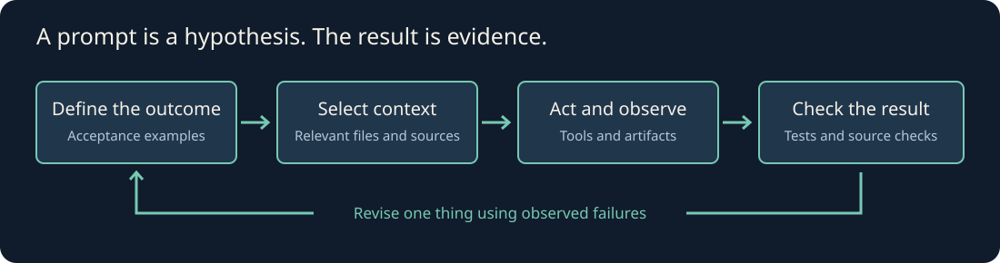

# Prompt Guide

**Learn to give AI work it can understand—and learn to check the result.**

A practical, evidence-backed field guide for people building with Codex, Claude Code, and other AI assistants. Start with a real task. Write the prompt. Inspect what happened. Improve one thing at a time.

## Start here

1. **Ten minutes:** [Write your first useful prompt](guides/01-prompt-contract.md). Copy the example and adapt it to your project.
2. **One session:** [Build a feature with an agent](guides/04-coding-workflow.md). Learn how to go from an idea to a verified change.
3. **One coding example:** [Inspect a real search fix](labs/search-fix/README.md), including before-and-after test output.
4. **One experiment:** [Compare prompts in Codex](labs/prompt-contract/README.md). Inspect real outputs and run the grader yourself.

No API key is required to read the guide or re-score saved results. Running new model trials requires a working Codex CLI account and may consume your account's usage.

## Learning path

| Lesson | What you will be able to do |
|---|---|
| [1. Define the task](guides/01-prompt-contract.md) | Turn an unclear request into a testable outcome |
| [2. Understand model behavior](guides/02-model-behavior.md) | Diagnose missing context, ambiguity, and unsupported claims |
| [3. Design context](guides/03-context-and-memory.md) | Use instructions, retrieval, and memory deliberately |
| [4. Build software](guides/04-coding-workflow.md) | Inspect, implement, test, and review a feature |
| [5. Tools, skills, and MCP](guides/05-tools-skills-mcp.md) | Choose the right extension and verify it works |
| [6. Harnesses and graphs](guides/06-harnesses.md) | Design bounded loops with observable completion |
| [7. Evaluate prompts](guides/07-evaluations.md) | Compare outputs fairly and avoid misleading scores |
| [8. Research like an engineer](guides/08-research-practice.md) | Check new claims and keep learning without chasing hype |

## Pick a prompt for today's work

[Prompt library](prompts/README.md): understand a repository · specify a feature · implement · debug · review · research · design an eval · critique · resume · design a tool · curate memory · learn a concept.

These are original templates derived from public practices. They are **not leaked internal prompts**, an official course, or a claim of affiliation with OpenAI or Anthropic. Template examples are labeled separately from observed model outputs. No prompt guarantees correctness.

## Evidence and maintenance

- [Research ledger](research/sources.md): what each source supports, its limits, and when it was checked.
- [Claim checks](research/claims.md): documented practices versus unverified stories.
- [FLOW.md](FLOW.md): scope, research decisions, validation, and remaining dependencies.
- [Memory handoff](memory/README.md): durable notes and the pending Supermemory integration.
- [Contribute](CONTRIBUTING.md): add examples with evidence, including negative results.

Source review date: **2026-10-19**. Version-sensitive product details need rechecking before use. This is a maintained learning repository, not a live news feed.
