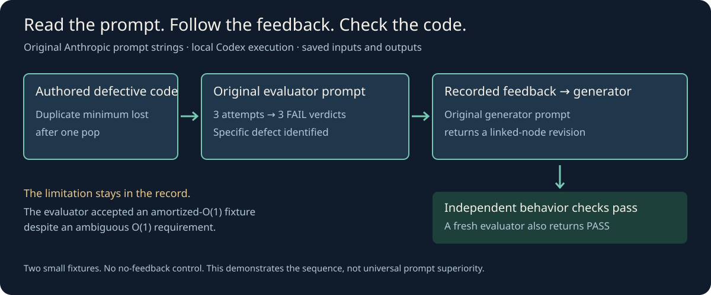

# Prompt Guide

**Real prompts. The systems around them. Results you can inspect.**

A resource for builders who want to see how AI-assisted work actually happens: original public prompts from Anthropic and OpenAI, the context and tools they depend on, workflow diagrams, and recorded examples.

**New to this? [Start here](START-HERE.md).** The connected handbook explains the concepts locally, with complete examples, diagrams, a glossary, and a runnable MCP connection. You do not need to read the linked blogs to follow it.

Already building? Explore the original artifacts and recorded cases below.

## See what is actually there

| Open this | What you will find |
|---|---|
| [Original public prompts](originals/README.md) | Six licensed artifacts from publisher-owned repositories, with exact revisions, hashes, and attribution |
| [An Anthropic engineer’s actual task prompt](cases/anthropic-game-maker.md) | A first-person experiment report, the exact task sentence, and the system that accompanied it |
| [A published evaluator prompt in action](cases/evaluator-loop/README.md) | Original Anthropic prompts, assembled requests, recorded feedback, and code checks |
| [Evidence-gated completion](cases/evidence-gate.md) | Original reviewer instructions and the difference between a prompt rule and a hook |
| [What reaches the model](cases/request-to-result.md) | How context, skills, plugins, tools, MCP, memory, and the harness fit together |
| [A verified coding change](labs/search-fix/README.md) | Prompt → changed code → three failed tests becoming five passes |
| [A comparison that tied](labs/prompt-contract/README.md) | The shorter and longer prompts both succeeded; the raw outputs are retained |



## Read the prompt in its environment

A task sentence, a system prompt, a skill, and an evaluator prompt do different jobs. Copying one without its expected files, tools, or runtime can change its behavior completely. Each original entry explains what supplies those dependencies and what has actually been verified.

Our labels are explicit:

- **Published original:** released by the named publisher, preserved with source attribution.
- **Reported experiment:** the original author describes the run; we have not reproduced it.
- **Executed here:** prompts, outputs, environment details, and checks are saved in this repository.
- **Our synthesis:** an explanatory diagram, adaptation, or template we authored.

We do not have access to private lab workflows, and a public source does not establish an engineer’s undisclosed daily prompting style. This repository is independent of OpenAI and Anthropic.

## Follow the evidence

[Case studies](cases/README.md) · [Original prompt entries](originals/entries.md) · [Source ledger](research/sources.md) · [Claim checks](research/claims.md)

The authored [prompt templates](prompts/README.md) remain available as adaptations for everyday work. They are not attributed to lab engineers.

For background, browse the reference notes on [model behavior](guides/02-model-behavior.md), [context and memory](guides/03-context-and-memory.md), [tools and MCP](guides/05-tools-skills-mcp.md), [harnesses](guides/06-harnesses.md), and [evaluation](guides/07-evaluations.md).

## Check it yourself

Reading the resource and rechecking saved artifacts requires no model account. Python 3 checks use only the standard library:

```bash
python3 scripts/check_links.py
python3 scripts/check_originals.py
python3 labs/prompt-contract/grade.py
python3 -m unittest discover -s cases/evaluator-loop -p 'test_*.py'
```

New model trials require the relevant account, runtime, tools, and usage budget. Local Codex reproductions are labeled separately from upstream Claude execution. Small demonstrations do not establish broad reliability or model superiority.

## Keep it honest and useful

[FLOW.md](FLOW.md) records research and implementation decisions. [Memory records](memory/README.md) retain provenance. [Contributing](CONTRIBUTING.md) explains how to add an original prompt or a reproducible case. [Launch preparation](launch/README.md) tracks the public-facing claims and remaining checks.

Sources last inspected: **2026-10-19**. Original files retain their upstream licenses and notices; see [originals/README.md](originals/README.md).
