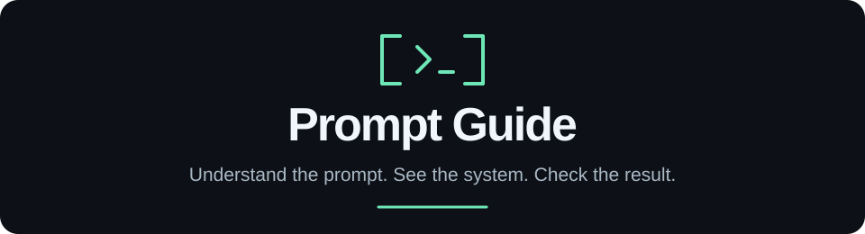

  

  Learn prompting from the first request to systems you can test. 
  Explanations, public prompts, diagrams, and recorded examples—all in this repo.

  <a href="START-HERE.md"><strong>Start here →</strong></a> ·
  <a href="ROADMAP.md">Full roadmap</a> ·
  <a href="updates/README.md">Updates</a> ·
  <a href="CONTRIBUTING.md">Contribute</a>

## Beginner → advanced

**Write a clear request → Understand the model → Supply context → Connect tools → Measure and improve**

| Stage | Learn to | Open |
|---|---|---|
| **01 · Prompt** | Define the task, examples, constraints, and expected answer | [Your first prompt](handbook/01-first-example.md) |
| **02 · Model** | Understand tokens, context, generation, and why fluent answers can be wrong | [How the model receives a prompt](handbook/02-model-and-context.md) |
| **03 · Context** | Choose evidence, retrieve information, and preserve useful memory | [Context and memory](handbook/04-context-and-memory.md) |
| **04 · System** | Connect skills, plugins, and MCP; follow an agent's execution loop | [Skills](handbook/05-skills-and-plugins.md) → [MCP](handbook/06-tools-and-mcp.md) → [Loops](handbook/07-harnesses-and-loops.md) |
| **05 · Evaluation** | Check results, compare changes, and diagnose failures | [Verification](handbook/08-coding-and-verification.md) → [Evaluation](handbook/09-evaluation-and-failures.md) |

### Go deeper

| Advanced track | What you'll explore | Status |
|---|---|---|
| **06 · Prompt experiments** | Zero-shot vs. few-shot, controlled comparisons, held-out cases, and failure analysis | [First lab available](labs/prompt-comparison/README.md) |
| **07 · Visual ML mechanics** | Token boundaries, next-token probabilities, temperature, and recorded continuations | [Interactive lab available](labs/model-mechanics/README.md) |
| **08 · Retrieval experiments** | Chunking, lexical/embedding search, and evidence failures | [Retrieval lab available](labs/retrieval/README.md) |
| **09 · Agent engineering** | Complete execution traces, tool errors, permissions, checkpoints, and recovery | [First trace available](labs/bounded-agent/README.md) |
| **10 · Reliable evaluation** | Judge calibration, uncertainty, regression tracking, cost, and latency | [Regression gate available](evaluation/README.md) |

**Start the [advanced developer practicum](labs/PRACTICUM.md).** Inspect real traces, diagnose failures, and work toward an [integrated capstone](labs/CAPSTONE.md).

**More advanced labs are coming.** Foundations and the linked labs are available now; deeper experiments and independent review remain planned. Follow the [full roadmap](ROADMAP.md) for scope and the evidence each addition needs.

## Explore

[Everyday examples](everyday/README.md) · [Original Anthropic & OpenAI prompts](originals/README.md) · [Developer labs](labs/README.md) · [Recorded experiments](cases/README.md) · [Prompt templates](prompts/README.md) · [Skills & MCP toolkit](toolkit/README.md) · [Glossary](handbook/glossary.md)

Read online with no installation or model account. To run examples locally, follow their setup instructions in [examples](examples/README.md).

## Evidence

Published originals, authors' reported experiments, local runs, and our explanations are labeled separately. See the [sources](research/sources.md) and [claim checks](research/claims.md). This project is independent of OpenAI and Anthropic.

## Contributing

Corrections, clearer examples, and reproducible experiments are welcome. Read the [contribution guide](CONTRIBUTING.md), then [open an issue](https://github.com/MananPoojara/Prompt-guide/issues) or submit a pull request.

## License

Authored code and documentation are available under the [MIT License](LICENSE). Third-party artifacts retain their [upstream licenses and notices](originals/README.md).

---

**⭐ If Prompt Guide helped you understand or improve a prompt, give the repo a star.**
