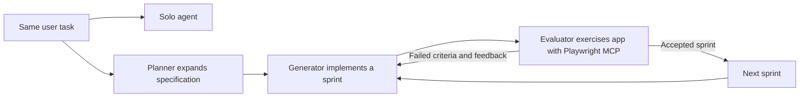

# The task prompt was one sentence. The system around it changed.

In a March 24, 2026 engineering article, Anthropic Labs engineer Prithvi Rajasekaran reports using this exact prompt:

> Create a 2D retro game maker with features including a level editor, sprite editor, entity behaviors, and a playable test mode.

[Original first-person report](https://www.anthropic.com/engineering/harness-design-long-running-apps)

## What accompanied the prompt

The author reports a solo run of 20 minutes and $9, compared with a full-harness run of six hours and $200. He describes a broken interaction in the solo result and a more capable full-harness result. These are the author's reported observations, not experiments we reran.

The full workflow added a planner, generator, evaluator, sprint agreements, persistent files, and browser testing. That comparison therefore does not isolate prompt wording as the cause. The published task sentence is real; the complete private runtime cannot be reconstructed from that sentence alone.

**What to inspect:** the original article's application screenshots, architecture description, and comparison conditions. A diagram here summarizes the published structure; it is not a captured execution trace.

## What a reader can take away

For a difficult build, ask which part of the system supplies specification, execution, feedback, and stopping criteria. Repeating the task sentence in an ordinary chat does not recreate those capabilities. Our [evaluator case](evaluator-loop/README.md) inspects one smaller piece using a different, explicitly public prompt.
