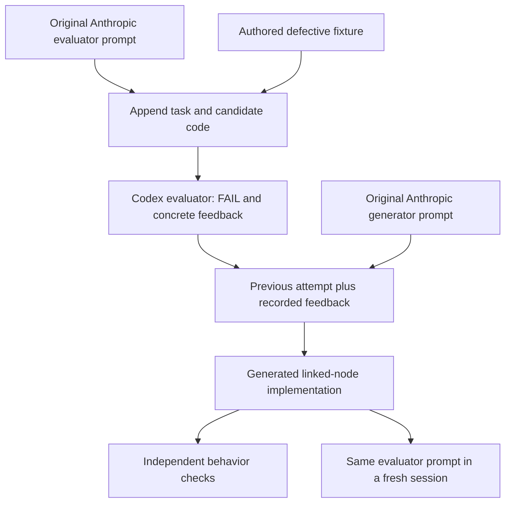

# An original Anthropic evaluator, a real bug, and a recorded revision

This case uses the **unchanged generator and evaluator strings** from Anthropic’s public evaluator–optimizer notebook. It shows the actual text, how requests are assembled, what the model returned, and what independent checks establish.

[Original notebook at the inspected revision](https://github.com/anthropics/claude-cookbooks/blob/a162e0184e71b60290808a43961a6cbc8060123c/patterns/agents/evaluator_optimizer.ipynb) · [Local evaluator text](../../originals/vendor/anthropic-cookbook/evaluator_prompt.txt) · [Local generator text](../../originals/vendor/anthropic-cookbook/generator_prompt.txt)

## The inputs are visible

The evaluator requests judgments about correctness, complexity, and style in XML fields. The notebook's `evaluate()` appends `Original task:` and `Content to evaluate:` to the prompt. The generator receives previous attempts and feedback before the task. Our request assembly follows those formats.

We supplied a small integer stack task and two authored fixtures, differing by one comparison operator:

```python
# Defective fixture: repeated minima are not recorded.
if not self.minimums or x < self.minimums[-1]:
    self.minimums.append(x)

# Behaviorally repaired fixture: equal minima are retained.
if not self.minimums or x <= self.minimums[-1]:
    self.minimums.append(x)
```

Push `3, 1, 1`, then pop once. The defective implementation returns `3` as the minimum even though `1` remains. The repaired fixture returns `1`. [Full task](fixtures/task.txt) · [Defective code](fixtures/buggy.py) · [Repaired fixture](fixtures/correct.py)

The filename `correct.py` is the initial fixture label, not proof that it satisfies every possible reading of the specification. See the complexity ambiguity below.

## The recorded flow



This graph describes the recorded local sequence. The first defective implementation was deliberately authored for the case; it was not an earlier model generation. The comparison fixture was also authored. The final revision is actual model output.

## What happened

| Input | Attempts | Observed evaluator verdict |
|---|---:|---|
| Defective duplicate-minimum implementation | 3 | FAIL in all 3 |
| Repaired comparison fixture | 3 | PASS in all 3 |

Order alternated between the two fixtures across repetitions. All six outputs were retained in [the run directory](results/run-2026-10-19). The [manifest](results/run-2026-10-19/manifest.json) records commands, exit status, and elapsed time. The complete assembled input and raw output are saved for each attempt.

We then supplied the first defective fixture and its actual feedback to the original generator prompt. It returned a linked-node implementation storing the minimum at each node, addressing both duplicate minima and the dynamic-array resizing concern.

- [Exact revision request](results/revision.input.txt)
- [Raw generator response](results/revision.output.txt)
- [Extracted generated implementation](results/revision.py)
- [Independent test output](results/independent-checks.txt)
- [Follow-up evaluator request](results/revision-evaluation.input.txt) and [actual verdict](results/revision-evaluation.output.txt)

The follow-up evaluator returned `PASS`. All eight independent fixture/revision checks passed.

Independent checks cover duplicate minima, empty-stack behavior, reuse after emptying, and 500 seeded mixed operations against a simple reference. Tests do not measure asymptotic complexity. Code inspection shows the revision uses a bounded number of node operations per stack operation under the usual unit-cost model; it is not a real-time performance guarantee.

## The evaluator also revealed a limitation

The task said each operation should be O(1). Both list-based fixtures use amortized O(1) append. The evaluator mentioned that distinction but still accepted the comparison fixture in all three runs. Under a strict worst-case interpretation, those PASS verdicts are too generous.

That matters: three successful bug detections do not make the model an infallible judge. We report the actual verdicts rather than calling this “100% evaluation accuracy.” A production rubric should settle worst-case versus amortized requirements before scoring. The generated revision changed data structure in response to the feedback.

## Environment and limits

Executed 2026-10-19 with Codex CLI 0.163.0, `gpt-6.1-sol`, reasoning effort `none`, fresh ephemeral sessions, user config ignored, and a read-only sandbox. The pinned upstream helper uses the Anthropic API with `claude-sonnet-4-6`, temperature 0.1, and a 4096-token output limit. **This is a cross-runtime reuse, not a reproduction of Anthropic’s model results.**

Two hand-authored implementations are a tiny diagnostic set, not representative coverage. The evaluator prompt is constant, so this does not establish that its wording beats a baseline prompt. The improvement from the defective candidate to the revision happened after concrete feedback and another generation; there was no no-feedback control. We have not separated the effects of prompt wording, model capability, and additional inference.

The notebook's open-ended loop is not copied as an unattended production loop. This case has a fixed run count. Its `thoughts` output is ordinary generated explanation, not privileged access to model internals.

## Recheck and rerun

No account is needed to inspect or check saved outputs:

```bash
python3 scripts/check_originals.py
python3 -m unittest discover -s cases/evaluator-loop -p 'test_*.py'
```

To run new evaluator attempts with your Codex account:

```bash
python3 cases/evaluator-loop/run.py --output /tmp/prompt-guide-new-evaluator-run --repeats 3
```

The output directory must not already exist. New model calls consume usage. Check the actual model/settings in the logs before comparing runs. To repeat the revision, send the saved revision input to a fresh Codex session and save the new output separately; do not overwrite the published evidence.
