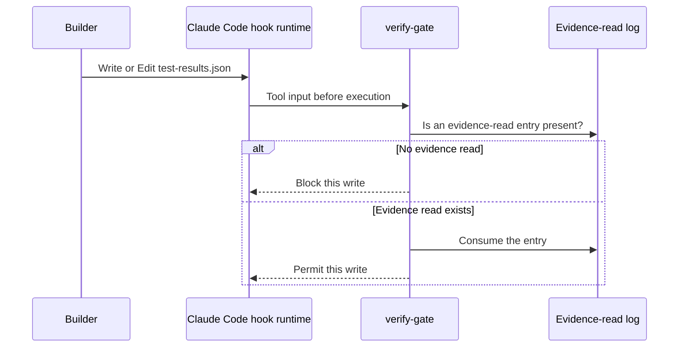

# A prompt can request evidence. A hook can check an action.

Anthropic’s Code with Claude 2026 repository publishes a reviewer prompt, handoff conventions, and example hooks. Its README calls them event-demo ingredients, not a maintained turnkey harness. [Pinned repository](https://github.com/anthropics/cwc-long-running-agents/tree/ad107a974bced5244f74dd283dbf2bfd3baee3a1)

Read the actual [evaluator instructions](../originals/vendor/anthropic-cwc/evaluator.md) and [handoff conventions](../originals/vendor/anthropic-cwc/CLAUDE.md).

The [original hook source](https://github.com/anthropics/cwc-long-running-agents/blob/ad107a974bced5244f74dd283dbf2bfd3baee3a1/claude-code-config/.claude/hooks/verify-gate.sh) checks for an evidence-read log before selected writes. Its own comments identify gaps: Bash can write around the hooked tools; filename matching is limited; any evidence read can unlock any result row. It does not prove that the evidence supports the claimed result.

The independent reviewer reads the specification, diff, and evidence, then returns a verdict. Its declared tool list and textual restrictions are part of the environment, not a magical property of the prompt. The source explicitly warns that Bash is not a hard read-only boundary.

**Local status:** source inspected; full Claude Code hook integration not executed here. The diagram depicts the source logic, not a measured run. Use it to inspect what is actually enforced before adopting the pattern.
