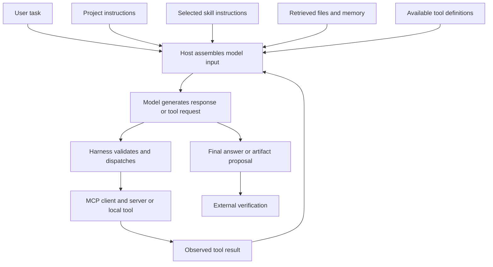

# What actually reaches the model

A chat box shows one message. An agent request may also contain host instructions, selected project instructions, skill content, tool definitions, previous outputs, and retrieved facts. The exact assembly and precedence depend on the host. This is a conceptual map, not a disclosure of a lab's private request format.

## Follow one concrete coding request

Suppose the user asks to repair search normalization. The agent needs the current implementation and intended matching behavior. A repository instruction can specify the real test command. A selected skill can supply a reusable debugging procedure. A tool reads files or executes tests. If an MCP server supplies browser automation, the host can expose that capability as tools. A plugin can package reusable instructions and connectors for installation. The harness runs the tool request, returns the observed result, and decides how the session continues.

These pieces have different jobs. A skill does not itself create a tool connection; an MCP connection does not itself choose a good test; a memory store does not guarantee the relevant record will enter the request. The [saved search case](../labs/search-fix/README.md) used local files and tests, and did not require MCP or a custom skill.

## How does the model “understand” the prompt?

At a useful engineering level, changing instructions and context changes the information on which the model conditions its generated output. Instructions can clarify the target; examples can constrain interpretation; tool results can supply facts the model did not have. This description does not reveal the internal causal mechanism for a particular answer.

The original Transformer paper introduced an attention-based architecture. It is foundational context, not documentation of the undisclosed architecture or training of every current model. [Attention Is All You Need](https://arxiv.org/abs/1706.03762)

A successful output is behavioral evidence. A convincing explanation of why the model produced it is not automatically an interpretability result. To investigate an improvement, keep the environment fixed, change one input factor, repeat on meaningful cases, and retain failures. The [tie case](../labs/prompt-contract/README.md) is an example of why we do not assume a larger prompt must win.

## Loop, graph, and memory are not synonyms

A loop repeats a transition until a stopping condition or budget. A workflow graph defines transitions, such as build → evaluate → revise. A knowledge graph represents relationships between facts or entities. A memory store persists records that may later be retrieved. None establishes correctness on its own.

Public references: [Codex skills](https://developers.openai.com/codex/skills), [MCP architecture](https://modelcontextprotocol.io/docs/learn/architecture), and [Anthropic's workflow patterns](https://www.anthropic.com/engineering/building-effective-agents). The graph above is our explanatory synthesis.
