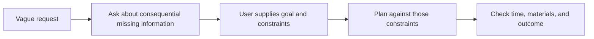

# Ask the question that changes the plan

[Everyday examples](../README.md) · [Planning within constraints](planning.md)

“Plan a workshop” leaves out the very thing that determines the agenda: what people should learn or make. A model can fill that blank with a plausible idea, but plausibility does not establish what you wanted.

## The vague request and instruction

Original request:

```text
Help me plan a workshop for our community group.
```

Instruction added for this demonstration:

```text
The request is missing information that would change the plan. Ask one concise question about the most important missing information, then wait for my reply. Do not invent the workshop topic, participants, duration, or facilities. Do not draft a schedule yet. Do not use tools.
```

## Recorded question

The model's complete first response:

> What topic or goal would you like the workshop to focus on?

It asks about the goal and stops. It does not choose a topic, assume a group size, or draft a schedule before the missing information arrives.

## Scripted user reply

This reply was written and frozen before the model calls. It is a teaching fixture, not an actual reader interview:

```text
It's a 60-minute paper-bookmark workshop for eight adult beginners. The goal is for each person to leave with a usable folded bookmark. We have square paper and pencils, but no projector, scissors, or glue. Include a 5-minute welcome, a 10-minute live demonstration, at least 30 minutes of practice, a 5-minute sharing/check, and 5 minutes of cleanup. Use any remaining time as buffer. Please give a simple minute-by-minute agenda in relative time ranges, not a clock-time schedule. Do not assume a date or start time.
```

## Recorded follow-up

A fresh session received the exact prior exchange plus the scripted reply. Its complete response:

> | Time | Activity |
> |---|---|
> | 0–5 min | **Welcome:** Introduce the goal: everyone leaves with a usable folded paper bookmark. Hand out square paper and pencils. |
> | 5–15 min | **Live demonstration:** Slowly demonstrate a folded corner bookmark using only square paper. Repeat key folds and show how it fits over a page corner. Seat everyone where they can see your hands. |
> | 15–45 min | **Practice:** Participants fold their bookmarks while you offer individual help. Use pencils for optional decoration. Check that each bookmark holds its shape and has an open pocket that can slip over a page corner. |
> | 45–50 min | **Buffer:** Allow extra folding time, troubleshoot tricky folds, or repeat a step as needed. |
> | 50–55 min | **Sharing/check:** Invite everyone to show their bookmark. Check the folds and pocket, and help with final adjustments. |
> | 55–60 min | **Cleanup:** Collect pencils, gather spare paper, and tidy the workspace. Participants take their bookmarks home. |

## Check what changed

The second request supplies the outcome, audience, duration, materials, and required activity lengths. The agenda can now be evaluated against specific constraints:

- Welcome 5 + demonstration 10 + practice 30 + buffer 5 + sharing 5 + cleanup 5 =60 minutes.
- Practice receives the required 30 minutes, and the blocks cover 0–60 without overlap or gaps.
- It uses relative times and invents no calendar date or clock start time.
- It requires paper and pencils, without adding a projector, scissors, or glue.
- The demonstration, practice, and final check all serve the usable-bookmark outcome.

The authoring assistant checked those facts against the reply. This is not a usability test, proof of teaching effectiveness, or independent review. No workshop was actually conducted.



## A failure to recognize

**Authored failure illustration, not a recorded response:** “Here is a two-hour photography workshop for teenagers, with a projector.” Nothing in the initial request establishes the subject, audience, time, or equipment. A detailed answer can still solve the wrong problem.

Do not turn every request into an interview. If the missing detail would materially change the answer, ask for it. If a reversible, low-impact assumption is sufficient, state that assumption and provide an adaptable draft. In this example the workshop's goal determines the content, so clarification comes first. Once the reply supplies the constraints, the model proceeds rather than repeating questions already answered.

See the [recording notes](README.md) for exact requests and limitations. The follow-up is reconstructed text in a fresh CLI session; it does not test native multi-turn session storage.
