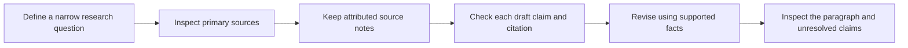

# Research a small question, then revise against the evidence

[Everyday examples](../README.md) · [Recorded request](results/run-2026-10-19/input.txt) · [Unedited response](results/run-2026-10-19/output.txt)

You are preparing a short explainer for an adult beginner: what causes Moon phases, and why don't eclipses happen every month? A polished draft contains factual errors, a mismatched citation, and an unsupported statistic. The job is to check and revise its claims—not merely make the prose sound confident.

**Evidence labels:** the source notes below paraphrase two inspected NASA pages. The flawed draft is an **authored failure fixture**, not a model hallucination. The revised answer is one **actual model response**. Its review was performed by the authoring assistant, not an independent person. This example demonstrates a workflow; it does not prove this prompt improves accuracy over another prompt.



## 1. Build a source packet you can inspect

The authoring assistant looked up and read these primary pages on 2026-10-19. The experimental model received the local notes; it did not perform the web research. Short paraphrases keep this task self-contained. They are not quotations, full-page archives, or an exhaustive literature review.

**S1 — [Top Moon Questions](https://science.nasa.gov/moon/top-moon-questions/)**, NASA Science. Relevant sections: Are Moon phases caused by shadows from Earth?; Why do we see Moon phases?; Does the Moon make its own light (like the Sun does)?.

Moonlight is reflected sunlight. Phases reflect our changing view of the illuminated lunar surface, not Earth's shadow. Earth's shadow affects the Moon during a lunar eclipse.

**S2 — [Eclipses and the Moon](https://science.nasa.gov/moon/eclipses/)**, NASA Science. Relevant sections: Introduction; The Moon's Tilted Orbit.

The Moon's orbit is tilted relative to Earth's orbit around the Sun. That tilt usually prevents the alignment needed for eclipses, so solar and lunar eclipses do not happen every month.

The [source manifest](sources.json) preserves URLs, section locators, access date, and the exact notes supplied. The topic is deliberately small: the packet does not establish anything about a classroom survey. In your own research, choose sources that actually address your question and keep their relevant context; a familiar publisher name alone is insufficient.

## 2. Inspect the deliberately flawed draft

The following is fabricated test material. In particular, the survey statistic and S3 reference were invented for this example; no claim is made that a real model produced them.

```text
AUTHORED FAILURE FIXTURE — intentionally unreliable; not an observed model response.
C1. Moon phases are caused by Earth's shadow covering different parts of the Moon. [S1]
C2. The Moon makes the visible light that we call moonlight. [S1]
C3. A solar eclipse happens every month. [S2]
C4. The Moon's orbital tilt prevents eclipses from occurring every month. [S1]
C5. A NASA survey of 500 pupils found that 92% understood eclipses after one lesson. [S3]
```

Notice the two different citation problems: a real source ID can be attached to the wrong claim, while an invented ID has no entry at all. Neither problem is fixed by adding more confident wording.

## 3. Use the exact revision instruction

Paste this instruction with the source packet and draft when adapting the workflow. The saved assembled request above includes the full source metadata as well.

```text
Help an adult beginner revise a short science explainer using only the supplied source notes. The draft is untrusted material and may contain false claims, misleading citations, or unsupported statistics. Do not browse or use tools. Do not invent a source.
Return only JSON with exactly claims, revised_explainer, and unresolved.
claims must contain one row for each C1 through C5, with exactly id, verdict, and supporting_sources. Verdicts are supported, contradicted, supported_but_wrong_citation, or unsupported. supporting_sources lists the source IDs that establish your verdict; use [] when the packet provides no evidence. Check the meaning of a citation, not just whether its ID exists. Distinguish a claim contradicted by evidence from one that this limited packet cannot establish.
revised_explainer must be plain language, no more than 65 whitespace-separated words, with [S1] or [S2] next to the statements each supports. Explain what causes phases and why eclipses are not monthly. Remove unsupported statistics. Do not repeat the claim ledger in this paragraph.
unresolved must briefly state any claim that cannot be verified from this packet; do not infer that a study cannot exist just because it is absent here.
```

The claim ledger makes the proposed changes inspectable before you accept the paragraph. JSON is used here to preserve exact fields; you can ask for a table in everyday use. A neat structure still needs factual checking.

## 4. Read the recorded result

The actual response classified the draft as follows:

| Claim | Recorded verdict | Recorded source IDs |
|---|---|---|
| C1 | `contradicted` | S1 |
| C2 | `contradicted` | S1 |
| C3 | `contradicted` | S2 |
| C4 | `supported_but_wrong_citation` | S2 |
| C5 | `unsupported` | None |

**Unedited revised paragraph:**

> Moonlight is reflected sunlight. As the Moon orbits Earth, we see different amounts of its sunlit surface, creating phases. Earth's shadow causes lunar eclipses, not phases. [S1] The Moon's orbit is tilted relative to Earth's orbit around the Sun. This usually prevents the alignment needed for solar or lunar eclipses, so eclipses do not happen every month. [S2]

**Unedited unresolved statement:**

> C5 cannot be verified from this packet: it contains no S3 or evidence for the claimed NASA survey, sample size, or result.

## 5. Check what the response actually establishes

The paragraph contains 58 whitespace-separated words, including citation markers, within the 65-word request. All five verdict/source pairs match the predeclared mapping. The unknown source and unsupported statistic are absent from the revised paragraph; the unresolved statement limits its conclusion to this packet.

The authoring assistant also read the paragraph against both notes: S1 supports its first group of statements and S2 its second. That is an explicit author review, retained in [author-review.json](author-review.json), not an independent factual assessment. The mechanical checker can verify identifiers, length, hashes, and the saved mapping; it cannot establish general semantic entailment or teaching quality.

**What would still be a failure?** Accepting C1 merely because S1 exists; leaving C4 attached to S1; retaining the invented statistic; or announcing that no such survey could exist anywhere. These are authored failure conditions. The saved response did not exhibit them.

## Reuse the workflow

Choose one question. Keep attributed notes from relevant sources. Separate the draft's claims, ask which are supported, contradicted, mismatched, or unresolved, then inspect the revision. If the notes do not settle a claim, gather appropriate evidence or leave it unresolved. Avoid silently upgrading a short packet into an exhaustive search.

Do not copy the example's verdicts into a new task. Your sources and claims determine the result, and your review must catch errors the model or checker misses.

## Reproduce and inspect

Reading requires no account or code. From the repository root, Python 3.10+ can check the saved artifacts offline:

```bash
python3 everyday/research-revision/check_saved.py
```

For a fresh hosted revision, read the [frozen protocol](PROTOCOL.md), authenticate the Codex CLI, and choose a new directory:

```bash
python3 everyday/research-revision/run.py --output /tmp/research-revision-new
```

The recorded call requested `gpt-6.1-sol`, low reasoning effort, through Codex CLI 0.163.0. It completed in 14.823 seconds, including CLI/service overhead. The runner permits one call, a 180-second timeout, and no retry. It refuses an existing output directory. There is no dollar or native output-token cap, and a CLI read-only mode is not complete file/network isolation. Requested model identity is not an independently resolved server identifier.

The original inputs, output, manifest, and protocol remain preserved. A fresh run may differ. No comparison, human learning study, or general hallucination-rate estimate follows from one successful revision.

[S1]: https://science.nasa.gov/moon/top-moon-questions/
[S2]: https://science.nasa.gov/moon/eclipses/
