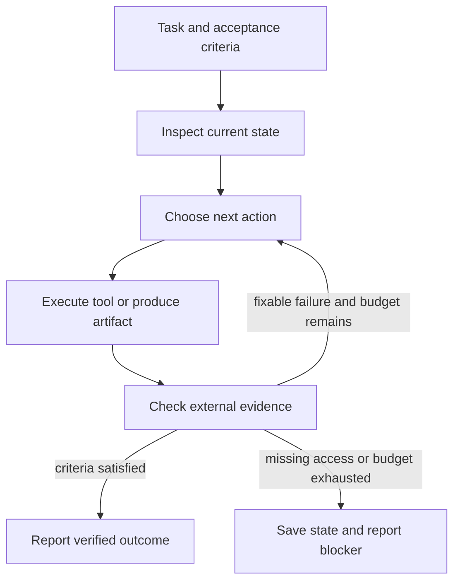

# 6. Make the workflow observable

A harness coordinates the model, context, tools, state, and stopping behavior. A graph describes possible transitions. Neither automatically improves an unclear objective.



This is an original teaching diagram. Each transition must be tied to evidence: a command result, artifact, test, or explicit user decision. A statement of intent is not a completed transition.

## Choose the smallest useful structure

| Structure | Good fit | Main cost |
|---|---|---|
| Single request | One bounded transformation | Limited recovery |
| Fixed workflow | Known stages and checks | Less flexible |
| Agent loop | Next action depends on observations | More variable cost and behavior |
| Parallel workers | Independent research or implementation boundaries | Coordination and conflicting changes |
| Evaluator and revision | Clear rubric and actionable feedback | Correlated errors and repeated expense |

Anthropic distinguishes predefined workflows from agents that select their next actions, and recommends adding complexity only when needed. Its 2024 article now flags changes in tooling; use the architectural distinction without assuming its product examples remain current. [Building effective agents](https://www.anthropic.com/engineering/building-effective-agents)

## A bounded revision contract

```text
Produce a draft against the supplied acceptance criteria. Check it against
those criteria using available tests or sources. Revise only for identified
failures, for at most two revision passes. Stop earlier if all criteria pass.
Preserve evidence of unresolved failures and report them if the budget ends.
```

Two passes is an example budget, not a research-derived optimum. A useful critic identifies a specific mismatch and a checkable correction. “Try harder” supplies no new information.

## Long-running work

Persist a feature list, completed checks, current revision, unresolved failures, and the next action. On restart, inspect these against the environment. Anthropic's long-running harness article describes initialization and incremental work with durable progress artifacts; this is one published design, not proof that every project needs the same scaffold. [Effective harnesses](https://www.anthropic.com/engineering/effective-harnesses-for-long-running-agents)

A knowledge graph is different from this execution graph: it stores entities and relations, such as a claim supported by a source and superseded by a later claim. Use one when relationship queries justify it. Markdown and stable IDs are enough for this repository's initial evidence ledger.


Next: [Evaluations](07-evaluations.md).
