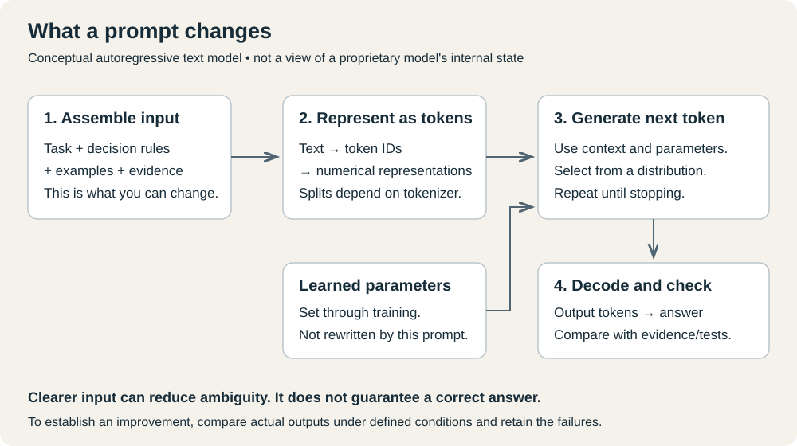

# 2. What the model receives

Previous: [First example](01-first-example.md) · Next: [Original prompts](03-original-prompts.md)

A language model generates a response from the input available to it. It does not automatically see your screen, your repository, your private notes, or the article whose title you mentioned. An application must supply that material directly or provide tools through which it can be retrieved.



This diagram is a conceptual explanation. It does not measure attention, reveal hidden reasoning, or show that one prompt performs better. The [interactive model-mechanics lab](../labs/model-mechanics/README.md) now adds actual token IDs, saved logits, and recorded continuations from a pinned small model. The [embeddings and attention lab](../labs/representations/README.md) adds actual token vectors, context-dependent representations, and every attention head from two inputs. Further depth remains on the [roadmap](../ROADMAP.md).

## Training and answering are different stages

During training, optimization changes the model's numerical parameters using training examples and objectives. Those parameters encode learned patterns and capabilities. During an ordinary request, the model uses its existing parameters to process the current input and generate output. That stage is called inference.

Adding “Alex has not accepted the task” to a chat changes the information available for that answer. It is not equivalent to retraining the model. An application can also save the fact and retrieve it in a future conversation; that is external memory. Whether a service separately retains data or uses it for training is a product/data-policy question, not something the presence of a chat message establishes.

## Text becomes tokens

A tokenizer represents text as a sequence of token IDs. A token may correspond to a word, a word fragment, punctuation, or another piece of text. There is no universal rule that one token equals one word. Different models and tokenizers can split the same sentence differently.

The model operates on numerical representations of these tokens. In a typical autoregressive language model, generation proceeds by predicting a distribution for the next token, selecting a token under the runtime's generation settings, then continuing. Training and architecture make this much more capable than a simple phrase lookup, but fluent continuation is still not an independent fact check.

Attention is a mechanism that lets representations at different positions incorporate information from other positions allowed by the architecture's mask. It helps explain how the model can connect “the deadline was changed” to a preceding date. It does not give us a human-readable guarantee that it interpreted the change correctly. This is a general architectural explanation, not a disclosure of every current model's internals. [Primary foundation: Attention Is All You Need](https://arxiv.org/abs/1706.03762).

## The context is the material available for this response

Think of context as the working packet for a particular request. It can contain instructions, conversation messages, documents, images, tool descriptions, and tool results, depending on the product and model. The context window limits how much can fit. Output also has limits; exact accounting varies by model and API.

The [context-budget lab](../labs/context-budget/README.md) records the exact tokens retained by prefix truncation, suffix truncation, and whole-document packing. It shows a question or its evidence disappearing before inference, without inventing model answers.

Here is an **illustrative** assembled request:

```text
Application instruction:
  Extract confirmed commitments. Preserve uncertainty.

User message:
  Turn the supplied notes into task records.

Supplied document:
  Alex proposed November 5. Nobody accepted ownership or a deadline.

Output requirement:
  task, owner, deadline; use null for unconfirmed values.
```

The labels show distinct purposes. A real API may represent them as messages and structured fields rather than concatenating these headings. The exact rendered request in a proprietary chat application is not necessarily visible to the user.

A role such as system, developer, user, assistant, or tool identifies where a message fits in the interaction. Applications and providers define instruction precedence. Quoted documents and tool results should be treated as evidence to process, not automatically as authority to rewrite the task. The presence of the words “SYSTEM MESSAGE” inside a webpage does not make that webpage a real system message.

## Why knowing the answer can still go wrong

Several failures can produce the same-looking mistake:

- The required fact never reached the model: the file existed, but was not read.
- The fact was supplied, but the request was ambiguous: “owner” might mean proposer or assignee.
- A large or conflicting context made the relevant detail harder to use.
- The model generated an incorrect interpretation despite a clear request.
- The application displayed or parsed the response incorrectly.

These causes need different repairs. Rephrasing the prompt cannot recover a document the tool failed to fetch. Increasing the context limit does not establish which of two conflicting dates is authoritative. A parser fix cannot correct a fact the model invented.

## Reasoning text is not a measurement of internal computation

A model can provide a useful explanation of its answer. You can ask it to identify which note supports each extracted field or show a calculation that you can verify. Such a response is another generated artifact; its confidence or detail does not prove the conclusion. Do not treat a written explanation as a complete transcript of the model's hidden internal computation.

For our notes example, an evidence citation to “No one accepted ownership” is useful because you can check it against the supplied text. A long statement that the model “carefully reasoned” is less useful if it still assigns Alex the task.

The practical habit is to inspect the input, the output, and an independent check. You do not need a theory of human-like understanding to see whether a proposed deadline became an incorrect commitment.
