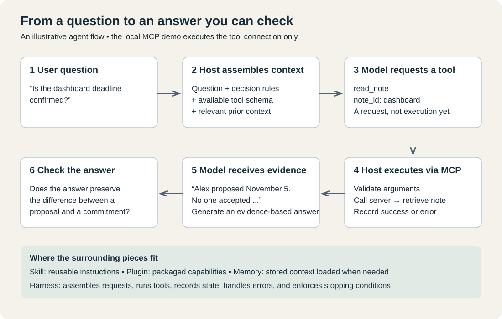
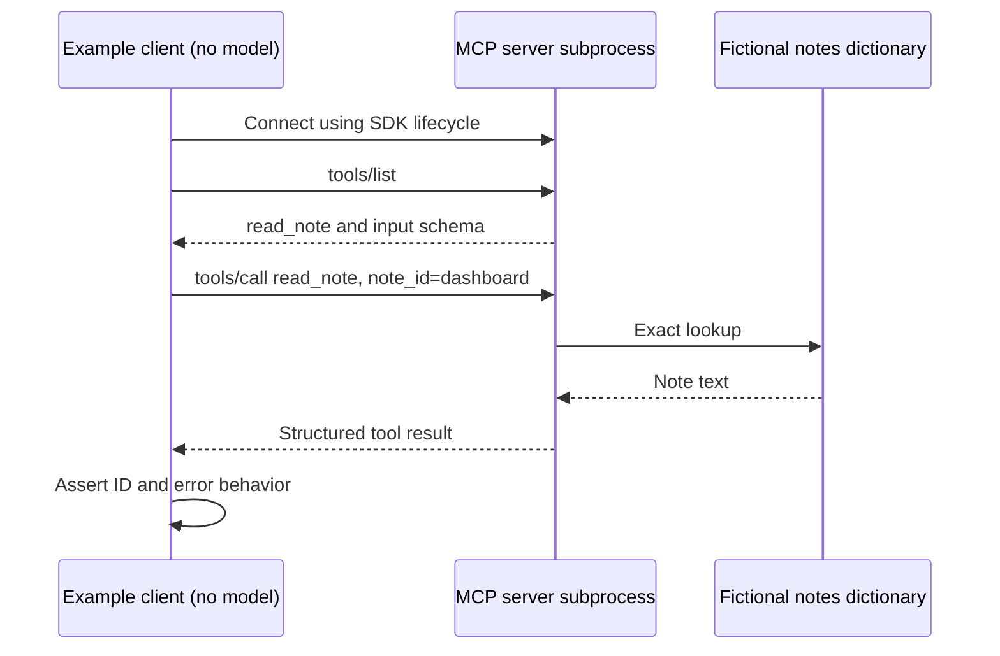

# 6. Tools and a real MCP connection

Previous: [Skills and plugins](05-skills-and-plugins.md) · Next: [Harnesses and loops](07-harnesses-and-loops.md)

A tool lets an application perform an operation beyond generating text: read a file, query a database, run a test, or retrieve a note. A model may propose a tool call, but the surrounding program is responsible for executing it and returning the result.

MCP, the Model Context Protocol, provides a shared interface through which applications connect to servers exposing capabilities. It does not supply reasoning or decide that a fact is true. Its architecture distinguishes the host application, its protocol clients, and the servers they connect to. Servers can expose tools, resources, and prompt templates. This example implements one tool. [Official architecture](https://modelcontextprotocol.io/docs/learn/architecture).



## The smallest complete useful example

Our [local server](../examples/mcp-notes/server.py) stores two fictional notes. Its tool is:

```python
@server.tool()
def read_note(note_id: str) -> dict[str, str]:
    """Read a fictional project note by exact ID: search-fix or dashboard."""
```

The Python function body performs an exact lookup and returns the matching record. The decorator registers it with the SDK. The type annotation `note_id: str` tells the SDK that the argument is a string. The generated input schema describes an object with a required `note_id` field.

A schema describes the shape of acceptable input. It does not prove that every string names an existing note. The function checks that separately. This gives us two distinct error cases: an omitted required argument and a well-shaped but unknown ID.

## Follow one request all the way through



The actual saved [result](../examples/mcp-notes/recorded-output.json) includes:

```json
{
  "id": "dashboard",
  "text": "Alex proposed 2026-11-05. No one accepted ownership or a deadline."
}
```

That is retrieved evidence, not a model's answer to whether the deadline is confirmed. A host with a model would next include the tool result in a model request. The model could then interpret it under the user's task and application rules. Our client stops before that step so the protocol behavior can be checked without model access or cost.

## Run it locally

The [example README](../examples/mcp-notes/README.md) includes the complete environment setup and commands. The only dependency directly specified by the example is `mcp==2.3.0`; it brings its own dependencies. The server and client use the SDK's version 2 interface, including `MCPServer` and `Client`.

In the recorded execution, the SDK negotiated protocol version `2026-07-28`. Older tutorials may show different initialization messages or different Python imports. Protocol versions and SDK versions are separate things. Use the pinned example as a unit rather than mixing code from incompatible tutorials. The SDK handles the connection lifecycle. [Official Python client documentation](https://py.sdk.modelcontextprotocol.io/client/).

This example uses **stdio**: the client launches the server as a local subprocess and exchanges protocol messages over its input/output streams. It does not start a public HTTP service. Protocol messages use standard output, so diagnostic logging belongs on standard error. Printing an unrelated banner to standard output can corrupt the exchange.

## What the run establishes

The client asserts that the server advertises exactly the expected tool, that `note_id` is required, that retrieving `dashboard` succeeds with the expected ID, that an unknown note returns a tool error, and that missing arguments return an error. Its recorded output marks `model_called` as false.

It does not establish model tool-selection accuracy, remote authentication, authorization across users, semantic search quality, or safe production deployment. Those are additional system properties that require additional implementation and checks.

## Tool descriptions help selection; runtime controls actions

In an agent application, the model sees a tool description and input schema. A precise description helps it choose the right operation and construct arguments. If several tools have overlapping names, selection can become ambiguous. If a result is too large or poorly structured, the next model request may be hard to use.

The host still decides whether to execute a proposed call, what credentials it uses, what filesystem or network access is allowed, and how to handle errors. “Only read files” in a prompt is not an operating-system permission. Our tool returns only two in-memory fictional records, so its behavior is easy to inspect; a real filesystem or database tool needs its own access controls.

A successful tool call means the operation returned a result. The host and model must still interpret that result correctly, preserve its provenance, and avoid treating instructions embedded in returned data as authority.
