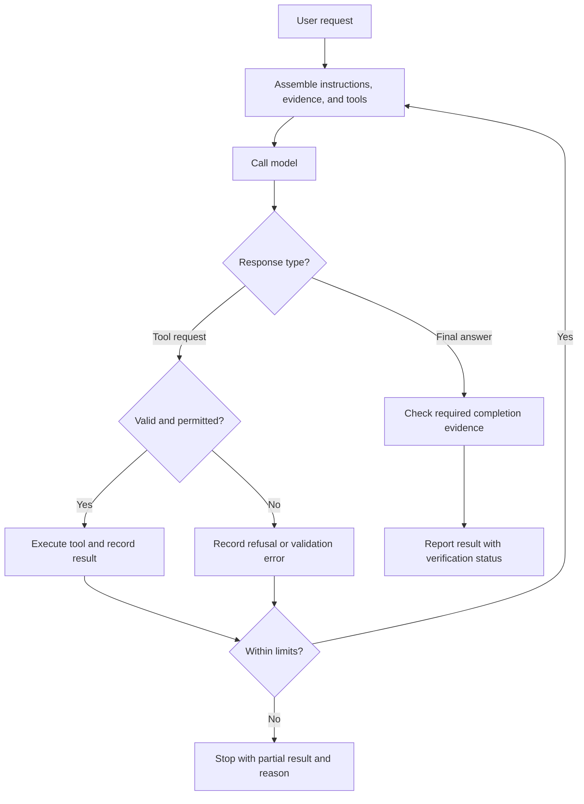

# 7. Harnesses, loops, and graphs

Previous: [Tools and MCP](06-tools-and-mcp.md) · Next: [Coding and verification](08-coding-and-verification.md)

A model call produces a response. An agent system can act on that response, collect new evidence, and call the model again. The surrounding software that assembles requests, executes tools, records state, and decides what happens next is often called a harness.

The harness is where a text instruction becomes a workflow. “Run tests before saying done” expresses a desired behavior. Code that records test exit status and refuses to mark a task verified after failure enforces a particular completion condition. These mechanisms complement each other, but they are not interchangeable.

## Trace a single tool loop

Imagine asking an agent whether the dashboard deadline is confirmed. Its first model request includes the question and the `read_note` tool description. The model proposes a call with `note_id="dashboard"`. The harness validates the call, executes the tool, and adds the returned note to the conversation. A subsequent model response can answer the question using that evidence.

The minimum state includes the original request, messages so far, available tools, tool results, and whether the workflow has ended. A useful implementation also records errors, elapsed time, and limits. The model does not automatically preserve this state outside the current request; the application maintains it.



This is an authored design diagram. It is not a claim about every detail of an OpenAI or Anthropic production runtime. The [request-to-result case](../cases/request-to-result.md) connects these components to the public material stored in this repository.

## A loop needs a stopping rule

The following is **pseudocode**, not a runnable agent or a record of a model trial:

```python
messages = assemble_request(user_task, selected_context, tool_schemas)
for step in range(MAX_MODEL_CALLS):
    response = call_model(messages)
    record(response)
    if response.is_final:
        return report_with_verification_status(response)
    calls = validate_tool_requests(response)
    results = []
    for call in calls:
        result = execute_with_permissions_and_timeout(call)
        record(result)
        results.append(result)
    messages = append_tool_exchange(messages, response, results)
return partial_result(reason="model-call budget exhausted")
```

A production implementation must define the functions and handle provider-specific message formats, multiple calls, malformed outputs, exceptions, cancellation, and token limits. The pseudocode makes the control structure visible without pretending those details are solved.

A maximum number of model calls alone is insufficient if a tool can hang forever. A practical budget can include call count, elapsed time, per-tool timeout, token use, and cost. Different limits protect different resources. If a deadline expires, report what was completed and what remains; do not convert a timeout into a success claim.

## Graphs make branches explicit

A workflow graph names states and the allowed transitions between them. For a coding change, states might be inspect, edit, test, review, and finish. An edge from test to edit means a failed test can trigger repair. An edge from test to finish might require a passing result. A graph can be implemented with ordinary code; it does not inherently require a graph library.

Some workflows use fixed rules for routing. Others ask a model to choose a route. That choice changes where uncertainty enters the system. “If test exit code is nonzero, return to repair” is deterministic routing. “Ask a reviewer whether the code is good enough” introduces a generated judgment that can be mistaken.

Parallel branches can reduce elapsed time when work is independent, but they add coordination needs. Two agents editing the same file can conflict. A reviewer who sees the generator's confident explanation may repeat its assumptions. More agents do not automatically produce better evidence.

## The evaluator–optimizer is a specific loop

In the [recorded evaluator case](../cases/evaluator-loop/README.md), evaluation identifies a duplicate-minimum bug, the generator receives that feedback, and a revised implementation is checked. The local sequence is finite and its requests are preserved.

The upstream notebook demonstrates a generation/evaluation loop. Before adapting such a pattern, decide what happens if the evaluator never returns PASS, returns an unparseable verdict, or keeps proposing stylistic changes after correctness is achieved. An evaluator criterion such as “no further suggestions” can be stricter and less stable than a concrete acceptance test.

A reviewer prompt and a test suite answer different questions. A reviewer can notice a missing requirement that the tests omit. A test can expose an execution failure that a confident review misses. A harness can retain both results without treating either as unlimited proof.

## Recovery depends on recorded state

If the process stops midway, a new session needs to know which files changed, which actions already ran, and which checks remain. Repeating a read is usually harmless. Repeating a purchase, deployment, or message send can have consequences. The runtime must distinguish actions that can safely repeat from those needing deduplication or explicit recovery logic.

For repository work, saved diffs, test logs, and a concise handoff make recovery inspectable. A final answer should state the actual completion condition: code changed, tests passed, review pending, or execution blocked. “The agent ran for a long time” is not itself a completion condition.

## Follow a real bounded run

The [bounded-agent lab](../labs/bounded-agent/README.md) retains all three model calls, tool results, and a deliberate checkpoint/resume. Inspect the host budget and read-only dispatcher alongside the model decisions. Simulated failure tests are labeled separately from the live trace.

The [controlled-failure extension](../labs/agent-recovery/README.md) records a model retrying a temporary read error and abstaining after a permission denial. The host injects and enforces the failure; the model chooses its response within the remaining budget.

## Compare the simpler workflow and review exact actions

The [strategy comparison](../labs/workflow-comparison/README.md) runs the same tasks through a single call, a fixed host rule, and an agent loop. All tied on the small reference set; the agent used more calls. The [action-approval lab](../labs/action-approval/README.md) then demonstrates an exact-proposal gate with a scripted reviewer, stale-target checks, and an explicit trusted-host boundary.
