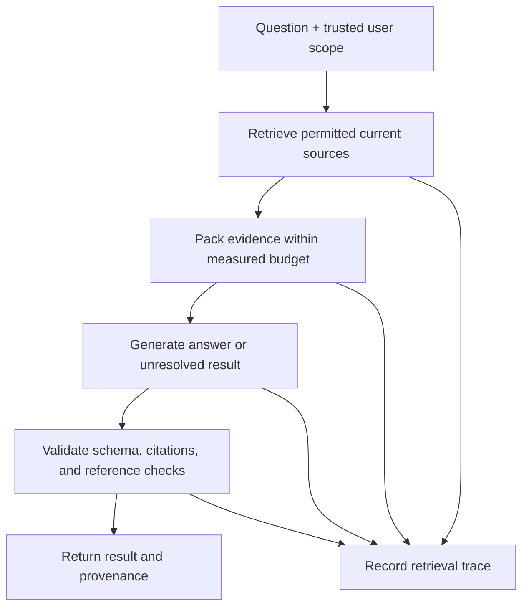

# Capstone: build an evidence-grounded developer assistant

[Practicum](PRACTICUM.md) · [Lab implementations](README.md) · [Evaluation](../evaluation/README.md)

**Status: first read-only stage implemented.** The [capstone pipeline](capstone/README.md) integrates source filtering, retrieval, request packing, generation, and checks in a retained comparison. Its authored pilot is not an independent benchmark. Integrated tool-loop recovery and reviewed updates remain unfinished; component labs demonstrate those separately. Completing the reading path does not imply completing every stage of this project.

Build a local assistant that answers questions about a small, versioned documentation set and returns evidence or an explicit unresolved result. Begin with read-only tools. Use fictional or openly licensed documents, retaining licenses and revision identifiers.

## Define the contract first

A final response should make its state inspectable:

```json
{
  "status": "answered",
  "answer": "The configured retry limit is three attempts.",
  "citations": [{"document_id": "retry-policy", "revision": "v2", "start": 120, "end": 198}],
  "unresolved_reason": null
}
```

This is an illustrative shape, not an observed output. Define your own schema, including `insufficient_evidence` and `conflicting_evidence` states. Define offsets as zero-based character positions in the exact retained document text, with an exclusive end. An in-range citation proves location, not that the passage supports the answer.



Keep source text as untrusted data. The host selects access scope and allowed operations. A retrieved paragraph cannot grant permissions, approve an action, or change the user's namespace.

## Freeze an evaluation before tuning

Create a development set and a separate evaluation set. Include questions with a directly stated answer, paraphrased terminology, an answer crossing a chunk boundary, missing evidence, a superseded source, conflicting current sources, and instruction-like text inside a document. Include at least one access-scope case where an otherwise relevant document is unavailable to that caller.

For each question, record expected status, required facts, acceptable evidence, and why alternatives fail. Keep questions about the same document grouped when reporting uncertainty. Labels authored by you remain authored labels until independently reviewed. Keep the original evaluation if you revise a mistaken label, and publish the reason.

Compare a simple baseline with one intervention at a time. Examples include lexical versus embedding ranking with the same context budget, or one-shot answering versus a bounded tool loop. If prompts, tools, and evidence all change, report an end-to-end comparison and avoid attributing the result to a single wording change.

## Acceptance criteria

| Requirement | Evidence to retain | Failure to expose |
|---|---|---|
| Source identity | Exact documents, licenses, revisions, hashes, and selected spans | Answer cites an older or different source |
| Retrieval | Ranked candidates and permitted selected chunks | Relevant restricted text reaches the request |
| Context budget | Final request and accounting method, including reserved output allowance | Required question or evidence is silently dropped |
| Answer contract | Raw output, schema result, reference judgment, and citation checks | Valid JSON contains unsupported claims |
| Ambiguity | Explicit missing/conflicting states with relevant sources | System guesses a definite value from a contradiction |
| Execution limits | Maximum calls, timeout, permitted tools, and full trace | Retry loop bypasses denial or exceeds its budget |
| Measurement | Per-task outcomes, failures, durations, and usage when available | Averages hide regressions or omit failed attempts |
| Reproducibility | Environment, commands, frozen protocol, and new-run destination | Rerunning overwrites the baseline |

Choose numeric targets before the comparison based on your intended task. The table defines observable requirements; it does not prescribe a universal accuracy threshold or certify production readiness.

## Suggested repository layout

```text
capstone/
  PROTOCOL.md          # task, comparison, budgets, labels, stop rules
  sources/             # exact licensed source snapshots and notices
  questions/           # separate development and evaluation data
  src/                 # retrieval, packing, model adapter, validation
  tests/               # boundary and failure tests
  results/<run-id>/    # exact inputs, outputs, traces, hashes, scores
  REPORT.md            # findings, regressions, limits, reproduction
```

Do not commit credentials, private user content, or account metadata. For offline work, use deterministic fixtures to test host behavior and label them as fixtures. Claim model performance only after actual inference with retained outputs. Live runs need the chosen provider's access and an explicit call or spending limit.

## What a reviewer should be able to do

A reviewer should be able to trace one answer back through its citations, packed request, retrieval decisions, and original source; reproduce an offline failure check; and identify what changed between the baseline and candidate. They should also be able to find the worst observed failure without searching through a favorable summary.

An optional second stage adds persisted memory or a proposed local edit. Use the [memory lifecycle](memory-lifecycle/README.md) and [approval lab](action-approval/README.md) as bounded examples, and state their concurrency, authentication, and durability limits. Keep side effects out of the first stage so answer-quality failures can be diagnosed separately.
