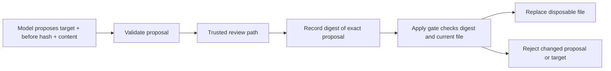

# Approve an exact proposed change, not an open-ended intention

[Developer lab path](../README.md) · [Agent recovery](../agent-recovery/README.md)

An agent can say “I will update the plan” while leaving the actual edit unclear. A reviewable action includes the target, the old state it depends on, and the complete proposed replacement. Approval should bind to those details.

This lab records one real model proposal to change a fictional plan's start time from 13:00 to 14:00. It then executes a **scripted review fixture** against a disposable local file. No human approval, external deployment, message, or user-file modification occurred.

## What ran

The model received the current file, its SHA-256, the fixed target `plan.txt`, and the approved decision. It returned data only. It had no application tool for approving or applying the edit.

```diff
-Start: 13:00
+Start: 14:00
 Capacity: 20
```

| Host step | Recorded outcome |
|---|---|
| Apply before approval | Rejected; file unchanged |
| Scripted fixture checks the complete expected edit | Approves that exact proposal digest |
| Add an unreviewed line to the approved proposal | Rejected; digest no longer matches |
| Apply the exact approved proposal | File updated in a fresh temporary directory |
| Replay in the same process | `already_applied`; no second replacement |

The [raw model output](results/run-2026-10-19/output.txt), [input](results/run-2026-10-19/input.txt), runtime log, and [host event record](results/run-2026-10-19/result.json) are retained. The experiment's review compares to an authored expected edit; it is not independent review of a general task.



## The boundary is in the host

The [gate](gate.py) accepts exactly one target name and three proposal fields. It rejects extra `approved` fields, unexpected paths, oversized/non-text content, malformed before-hashes, and symlink targets. The current raw-response parser also rejects duplicate JSON keys before review. That parser hardening was added after the original valid recording; the original frozen implementation and output are retained, and replay verifies that output under the stricter parser.

The approval digest covers the complete parsed proposal. A changed target, old-state hash, or replacement text requires a different approval. Before replacement, the gate checks that the target still matches the original hash. The test suite verifies rejection when another edit has already changed it.

`Gate.approve` is a **trusted-host API**, not a model tool or an authentication system. The demonstration calls it from the scripted reviewer only. A production application must establish reviewer authority and prevent the model process from changing approval state. A JSON field or hash provided by an untrusted caller is not evidence of authorized consent.

## What this example deliberately does not guarantee

The approval and applied sets live in one process. They are not a durable distributed ledger. Same-process replay does not prove exactly-once behavior across crashes. Replacement is atomic, but the separate hash check and replacement do not provide a concurrent-writer transaction or protection from an attacker modifying the directory between checks. The demo owns its temporary directory and assumes no concurrent writer there.

A production design needs appropriate isolation, durable action state, and a transactional or concurrency-safe execution mechanism for its side effect. Approving a local file replacement is also different from approving a payment, deployment, or public message. Keep the exact affected resource, scope, and authority visible at the real review boundary.

## Reproduce without a model account

Python 3.10+ only:

```bash
python3 -m unittest discover -s labs/action-approval -p 'test_*.py'
python3 labs/action-approval/check_saved.py
```

The checker reconstructs the original request, parses the recorded model proposal, and repeats the host sequence in a new temporary directory. The tests additionally cover stale targets, path allowlisting, symlinks, invalid fields, duplicate keys, and tampering.

For a fresh model proposal, an authenticated Codex CLI and access to `gpt-6.1-sol` are required. One call consumes account usage; use a new output directory:

```bash
python3 labs/action-approval/run.py --output /tmp/action-approval-run
```

The [protocol](PROTOCOL.md) fixes the one-call scope and scripted-review limitation. A proposal that differs from the expected fixture is retained and rejected by that review; it is not silently repaired or applied anyway.
