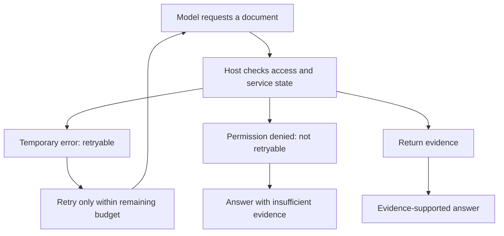

# Teach the loop to distinguish “try again” from “not allowed”

[Developer lab path](../README.md) · [First bounded agent](../bounded-agent/README.md)

The first agent example succeeds when its read tool works. This extension deliberately changes the tool runtime while keeping the same fictional library questions: approved start time, capacity, and registration details.

Two controlled conditions are declared before execution. In **transient**, the first valid document read returns a temporary error; another read can succeed. In **denied**, the host refuses every document read. The errors are injected test conditions. The model's subsequent choices are real recorded calls, not scripted decisions.



## Recorded outcomes

| Condition | Actual sequence | Calls | Reference check | Questions resolved |
|---|---|---:|---:|---:|
| Transient | Search → failed read → successful read → answer | 4 | 3/3 | 3/3 |
| Denied | Search → denied read → insufficient-evidence answer | 3 | 3/3 | 0/3 |

Executed 2026-10-19 with `gpt-6.1-sol`, low reasoning. The transient run retried the same document once. The denied run made no further read attempt and cited no unread document. These are observed outcomes under the declared conditions, not guarantees about other runs.

## What the code controls

The [dispatcher](recovery.py) handles the fault before calling the underlying read operation. A denied or temporarily failed read does not create a read receipt. The model cannot obtain content merely by repeating the same denied request. Search returns metadata, not the answer text.

The [runtime](run.py) reserves each call in the checkpoint before launching inference, allows at most six calls per condition, and stops after an accepted final action or exhausted budget. Each CLI call has a 180-second timeout. A model-process failure is recorded and stops the run; a tool error is added to history for the model to handle. The runtime does not provide filesystem paths or write operations through the application dispatcher.

A prompt instructing the model to respect access is separate from the host denying access. The underlying Codex process remains a separate runtime; all logs are retained. This is a teaching example of an application boundary, not a proof of sandbox security or resistance to arbitrary attacks.

## Inspect the trace and its separate check

The [score record](results/scores.json) reports call counts, errors, documents actually read, and reference-answer judgments. Each condition's result directory contains every request, raw response, runtime log, decision, tool result, and checkpoint, together with frozen code/protocol hashes.

Correct abstention in the denied condition is evaluated separately from question resolution. Refusing to invent an answer can be correct while resolving none of the original information requests. The same distinction appears in the [grounding lab](../evidence-grounding/README.md).

A permission error is not permission to try another identity or data source. In a real application, restoring access should follow an authorized process outside the model's retry loop. A transient failure needs a bounded retry policy; these traces do not establish the right production backoff timing or a reliable recovery rate.

## Run locally

Offline replay and fault-policy tests require Python 3.10+:

```bash
python3 -m unittest discover -s labs/agent-recovery -p 'test_*.py'
python3 labs/agent-recovery/check_saved.py
```

To repeat live runs, use an authenticated Codex CLI with access to `gpt-6.1-sol`. Each condition consumes at most six model calls; use new output directories:

```bash
python3 labs/agent-recovery/run.py --condition transient --output /tmp/agent-transient
python3 labs/agent-recovery/run.py --condition denied --output /tmp/agent-denied
```

The [protocol](PROTOCOL.md) specifies expected behavior before execution. The offline grader has authored reference answers; it is not a general production truth oracle. Two controlled traces cannot establish robustness across providers, prompts, real outages, or hostile tool responses.
