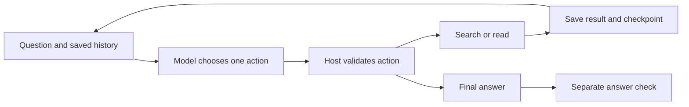

# A model chooses tools; the host sets the boundary

[Roadmap](../../ROADMAP.md) · [Previous: evidence grounding](../evidence-grounding/README.md)

The question is unchanged: when does the fictional library club start, how many people can attend, and is registration decided? This time the model must find the evidence. The host offers two read-only operations: search document metadata and read a known document. It interprets the model's JSON response as an action.



## What actually happened

Executed 2026-10-19 with `gpt-6.1-sol`, low reasoning, through Codex. The task uses JSON action dispatch, not a provider-native tool-calling API. The underlying Codex process is a separate runtime; its logs are retained.

| Call | Model decision | Host result |
|---|---|---|
| 1 | Search for the approved club details | Superseded draft first, current plan second; metadata only |
| — | Process deliberately stopped | Checkpoint retained the search result and one consumed call |
| 2, after resume | Read `current-plan` | Approved document returned and read receipt recorded |
| 3 | Return answers with citations | Start `14:00`, capacity `20`, registration `null`/`undecided` |

The [saved state](results/resumed-2026-10-19/state.json) contains decisions, results, command lines, and durations. Each call also has its full input, output, runtime log, and checkpoint. A separate scorer checked **3/3 answers** against the authored reference. One successful run does not establish agent reliability or superiority over the single-call example.

## What the host enforces

- Six calls maximum, including failed attempts. Budget is reserved on disk before calling the model.
- A 180-second timeout per call. A timeout stops execution and retains the attempt.
- Exact allowed action arguments and document IDs; arbitrary paths and write operations are unavailable through this dispatcher.
- Citations must refer to documents read during this run. This establishes provenance, not factual correctness; the independent scorer checks content.
- Atomic checkpoint replacement. An interrupted pending call requires inspection rather than an automatic retry. Explicit resume after a recorded failure still consumes the remaining budget.

Normal checkpoint/resume was executed live. Denied actions, invalid arguments, exhausted budgets, timeouts, and interrupted calls are **simulated unit tests**. Read-only operations make this example simpler than recovering an external payment or message. There is no claim of exactly-once external effects, sandbox security against malicious models, or general crash recovery.

## Run it

Requires Python 3.10+, an authenticated Codex CLI, and access to the recorded model. Live runs consume account usage. Use a new output directory:

```bash
python3 labs/bounded-agent/run.py --output /tmp/my-agent-run --stop-after 1
python3 labs/bounded-agent/run.py --output /tmp/my-agent-run --resume
```

Offline checks need no model account:

```bash
python3 -m unittest discover -s labs/bounded-agent -p 'test_*.py'
python3 labs/bounded-agent/check_saved.py
```

Inspect [the prompt](prompt.txt), [dispatcher](agent.py), [runtime](run.py), and [predeclared protocol](PROTOCOL.md). The first two documents from the grounding corpus are frozen with the code and their hashes. The trace checker reconstructs requests, replays tool decisions, and checks final answers; it does not rerun inference.
