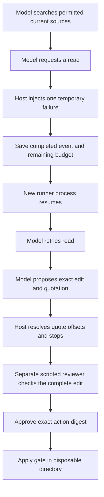

# From retrieved evidence to a reviewed update

[Capstone](../CAPSTONE.md) · [Read-only first stage](../capstone/README.md) · [Results](RESULTS.md) · [Frozen protocol](PROTOCOL.md)

This second stage connects a model-directed tool loop, a controlled read failure, a saved checkpoint, an evidence-linked edit proposal, and a separate approval gate. One actual run used four model calls across two runner processes. The **reviewer is a scripted fixture**, not a human. All writes occur in a new disposable directory; no user file, external service, or repository content is edited by the model's proposal.

The task is concrete: update a fictional workshop plan from `13:00` to the currently approved `14:00`, preserving capacity `20`. The complete [documents](documents.json), [instruction](prompt.txt), exact requests, outputs, and intermediate states are retained. This is original authored material under the project's [MIT license](../../LICENSE), with no independent annotation.



## Which decisions belong to the model?

The model chooses `search`, `read`, `propose`, or `unresolved`. The host fixes scope to `team-a`, excludes superseded sources, limits the call budget, validates action shapes, and stops a valid proposal at `awaiting_review`. There is no application `approve`, `apply`, or `send` tool. Extra approval fields are rejected.

The first permitted read fails once by design. The initial process exits after saving that completed failure. The next process loads the same history and consumed budget. The model then chooses to retry. This demonstrates **graceful checkpoint continuation**, not an unplanned process crash, genuine service outage, or distributed recovery guarantee.

If execution stops while a model call is marked pending, automatic resume is refused: the result is uncertain, and blindly retrying would hide that uncertainty. Every call is reserved before inference, including failed or malformed responses. Maximum six calls; a timeout or failed process stops the run. A final permission denial is distinct from the injected retryable failure.

## How does evidence become reviewable?

The model quotes a unique passage from a current permitted document that it has read. The host resolves that exact quote to original source offsets. In the saved run, it resolves the full decision to `[0,113)`. This avoids asking the model to calculate character positions as in the first capstone. It is an interface change demonstrated on one different task, **not a controlled accuracy comparison**.

A uniquely resolved quote proves where the text came from; it does not prove the edit follows it. The scripted reviewer therefore checks the complete expected replacement and the decision phrase separately. A valid but wrong proposal can reach review and be rejected. The fixture is specific to this authored task; it is not a general semantic judge.

The approval gate is copied byte-for-byte from the [earlier approval lab](../action-approval/README.md). The checker verifies that identity. Its digest binds the target, original file hash, and replacement content. The quote and source history are retained separately in the trace; they are not part of that edit digest, and this fixture does not revalidate later source changes.

## Inspect without an account

From the repository root (the directory containing `START-HERE.md`), with Python 3.10+:

```bash
python3 labs/capstone-update/check_saved.py
python3 -m unittest discover -s labs/capstone-update -p 'test_*.py'
```

No package installation, network, or model account is needed. The checker replays actual recorded actions, reconstructs each request, checks source/output hashes and checkpoints, and repeats the scripted apply probes in a fresh temporary directory. It verifies the completed saved sequence; an interrupted or incomplete new run will not pass that completed-sequence check.

Read [the paused state](results/resumed-2026-10-19/pause-state.json), [the resumed read request](results/resumed-2026-10-19/3.input.txt), [the actual proposal](results/resumed-2026-10-19/4.output.txt), and [the separate scripted review record](results/resumed-2026-10-19/review-fixture.json). This is the complete path from source lookup to a reviewable action.

## Run a new experiment

This consumes hosted model usage and requires an authenticated Codex CLI with access to the requested model. Read the protocol first. Choose a new output directory; do not overwrite the baseline:

```bash
python3 labs/capstone-update/run.py --output /tmp/capstone-update-new
python3 labs/capstone-update/run.py --resume --output /tmp/capstone-update-new
python3 labs/capstone-update/review_fixture.py --run /tmp/capstone-update-new
python3 labs/capstone-update/check_saved.py --run /tmp/capstone-update-new
```

Run the resume command only after the first process reports its completed-event pause. If it stops for another reason, inspect `state.json`; do not assume a successful checkpoint. The third command is an explicitly scripted approval simulation that may modify only a fresh temporary plan. It does not solicit or establish human consent. Existing review records are refused.

Each model call has a 180-second timeout. The full request has a 16000-byte host limit and output parsing has an 8192-byte limit after generation. These byte limits are not native model token limits and do not cap output charges. No dollar cap is enforced. Requests/results retain final messages and command metadata; CLI hidden reasoning, stdout/stderr, and account metadata are omitted. A read-only CLI mode is not complete isolation from local files or networking.

## Limits of the integration

The corpus has one permitted current decision, so retrieval is deliberately simple. The first stage supplies the more varied retrieval comparison. This run establishes that these components can work together on this task, not a success rate across tasks.

Checkpoint files and source metadata are trusted local inputs. A caller able to rewrite them can bypass the teaching host. Approval state lives in one process; same-process replay is not durable exactly-once execution. The hash-check/file-replacement sequence assumes no concurrent writer and does not implement a filesystem transaction. There is no authenticated reviewer identity, source reauthorization, multi-user isolation, or production deployment.

Fourteen local tests cover schema/quote checks, scope denial, repeated quotations, stopped/budget-exhausted states, timeout and invalid-JSON fixtures, changed-source resume refusal, oversized requests, and the complete scripted review/apply path. Unit coverage reaches 100% of the 67-statement workflow module and 98% of the 105-statement runner; the combined workflow/runner/gate/reviewer coverage is 88%. These are code-execution measurements, not a security certification or additional model trials.
