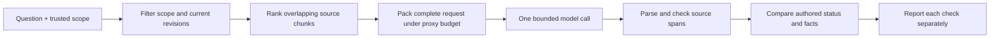

# A complete read-only evidence pipeline

[Capstone specification](../CAPSTONE.md) · [Results](RESULTS.md) · [Frozen protocol](PROTOCOL.md)

This implements the capstone's first stage: a question goes through trusted scope/current-revision filtering, lexical retrieval, request packing, one model call, and separate schema, citation, and answer checks. Every input and final output is retained. A later stage still needs to integrate the existing loop/recovery and proposed-edit components; this lab does not claim that stage is complete.

The documents are **authored fictional policies**, available in full in [documents.json](documents.json) under the project's [MIT license](../../LICENSE). The [questions](questions.json) include two development cases and eight evaluation cases fixed before inference. They cover direct and paraphrased questions, a chunk boundary, absent evidence, a superseded value, conflicting current decisions, quoted instruction-like text, and a restricted source. These labels have no independent human review.



## What changes in the comparison?

Both methods use the same documents, lexical overlap score, instruction, and input ceiling. **top1** supplies at most one chunk; **top3** supplies at most three. Chunks contain 128 characters with a 96-character stride. The difference is the amount of retrieved evidence, not a secret prompting phrase. More evidence can reveal a contradiction that a single chunk hides, but can also add irrelevant material.

The host filters before ranking. Source metadata is trusted input in this teaching fixture; production ingestion must establish that trust. Restricted source text is not sent to the model. This is a local program, not an authentication service or a security sandbox.

## Follow a recorded question

From the repository root (the directory containing `START-HERE.md`), run with Python 3.10+:

```bash
python3 labs/capstone/view_results.py --question conflict
python3 labs/capstone/check_saved.py
python3 -m unittest discover -s labs/capstone -p 'test_*.py'
```

These commands need no account, network, or extra packages. The viewer prints the authored reference separately from both methods' selected source spans, actual output, and checks. The checker verifies frozen source/code hashes, source filtering/ranking, request reconstruction, output hashes, and exact regrading. It checks stored token-count consistency; exact tokenization and greedy selection replay require the optional command below.

## Read the checks separately

| Check | Establishes | Does not establish |
|---|---|---|
| Schema | Correct keys/types and answer/unresolved state shape | Factual correctness |
| Citation provenance | Every cited interval lies in a selected current permitted revision | Passage entails the answer |
| Required documents | Authored necessary source IDs are cited | Every relevant source was retrieved |
| Reference spans | Cited intervals cover authored fact characters | General semantic entailment |
| Reference correctness | Status and normalized concise value match the authored key | Independent label correctness |

A “pass” requires all five. A correct value with an incomplete citation can fail; a plausible answer grounded in only one side of a contradiction can also fail. The unresolved reason must be nonempty, but its quality is not automatically graded. Inspect the raw output before interpreting failures.

## Budget and execution limits

The packer measures the **whole request**, including instructions, question, metadata, and source text, using the pinned MiniLM tokenizer. It permits 1024 input units and designates 256 output units in a 1280-unit teaching envelope. **These are proxy units, not the hosted generator's tokenizer or enforced output-token limit.** The program does not silently drop the question or truncate chunks. It stops before inference if instructions and question alone exceed its input ceiling.

There is one call per evaluation question per method: at most 16 calls, each with a 180-second timeout, with no retry. The parser rejects final responses exceeding 8192 UTF-8 bytes after generation; this does not stop the generator from consuming more output tokens. There is no dollar spending cap. No application tools or write actions are exposed. A CLI read-only setting is not complete process/network isolation.

For exact packing replay, use the [pinned model environment](../model-mechanics/requirements.txt) with the recorded tokenizer revision cached:

```bash
python3 labs/capstone/check_saved.py --retokenize
```

For a **new hosted experiment**, read the frozen protocol, authenticate the Codex CLI, and use a new destination:

```bash
python3 labs/capstone/run.py --offline --output /tmp/capstone-new-run
```

Here `--offline` disables tokenizer downloads only; the 16 answer calls still contact the hosted model service and consume account usage. Without a cached tokenizer, omit the flag to allow its download. Existing output directories are refused. The runner records requested model/settings, CLI version, durations, exact final responses, and source/code snapshots; hidden reasoning and account metadata are omitted. Requested model names are not independently resolved server identifiers, and missing billing records do not mean zero cost.

The 12 local tests include scope/revision exclusions, whole-request overflow, citation and schema failures, conflict evidence, parser size/duplicate-key rejection, and runner timeout/process/JSON-failure fixtures. They exercise 100% of the 69-statement pipeline module and 99% of the 74-statement runner module under coverage.py; the uncovered runner line is its script entry point. These percentages describe exercised code, not model accuracy or comprehensive security.
