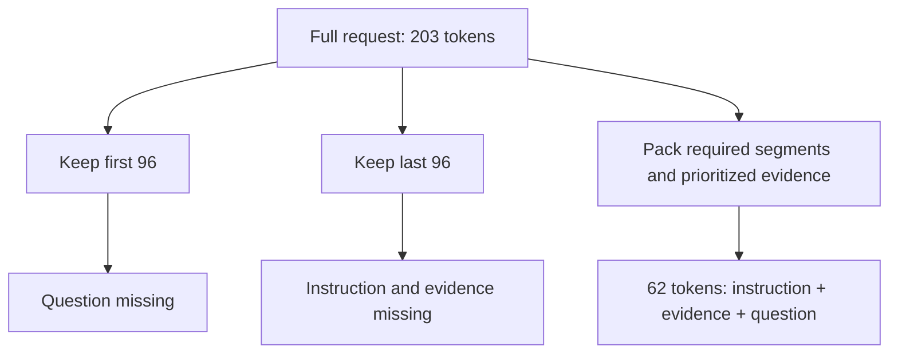

# A context limit is an input-selection problem

[Developer lab path](../README.md) · [Tokens and sampling](../model-mechanics/README.md) · [Retrieval](../retrieval/README.md)

A document can be available on disk yet absent from the final request. An application may select, truncate, or summarize material before inference. To diagnose an answer, inspect the request after that processing—not only the original files.

This lab tokenizes one complete request and records three ways to fit it into a small application budget. No model generates an answer. The outcome is exactly which instruction, evidence, and question remain in the input.

## Follow the actual token counts

The example reserves 16 tokens for a potential output inside a fictional 112-token application capacity, leaving 96 tokens for input. These numbers are teaching choices, **not** the recorded model's maximum context window or any provider's chat-message accounting.

| Recorded packet | Input tokens | Instruction retained | Complete evidence retained | Question retained | Fits 96-token input budget |
|---|---:|---|---|---|---|
| Full request | 203 | Yes | Yes | Yes | No |
| First 96 tokens | 96 | Yes | Yes | No | Yes |
| Last 96 tokens | 96 | No | No | Yes | Yes |
| Whole-document packing | 62 | Yes | Yes | Yes | Yes |

The evidence is a fictional approved library decision: the workshop starts at 14:00. Three archive paragraphs discuss furniture, posters, and stationery without supplying the requested time. In the full request, the question follows that background material.



The [raw recording](results/run-2026-10-19/data.json) retains exact token IDs, decoded text, individual token pieces, and segment-presence checks. The prefix/suffix results are actual slices of the full token sequence. The packed request is separately tokenized after assembly.

## How the packer works

The [implementation](packing.py) preserves the instruction and question as required segments. If those alone exceed the budget, it raises an error. It then considers whole documents in a supplied priority order, retaining each only if the resulting complete request fits.

The approved paragraph is placed first by the authored fixture. This lab does not discover that ranking or prove a retrieval algorithm works; the separate retrieval lab evaluates that problem. All three archive paragraphs are omitted. The remaining 34 input tokens are deliberately unused because another complete document does not fit. Filling every available token is not the objective.

Every trial assembly is counted as a complete string. Tokenization at boundaries can differ from counting independent fragments, so the code does not assume their token counts add exactly. The recorded implementation uses the pinned DistilGPT2 tokenizer without special tokens. Production chat roles, tool schemas, images, and output accounting require the actual interface's rules; this plain-text example does not count those.

## Diagnose the right layer

If required evidence was cut out, changing “think carefully” to “think very carefully” cannot put it back. Improve selection or supply the missing source. If all necessary evidence survived but the answer is wrong, investigate interpretation, instructions, or output checks separately.

A context-limit error, truncation, and summarization are different application behaviors. Do not assume an oversized request is always silently cut. Record the actual assembled request and any error. A summary also needs checks for lost qualifiers, source IDs, and unresolved conflicts; shorter text is not automatically equivalent evidence.

The packed request retains all predefined segments. That does not establish answer accuracy, universal prompt superiority, or optimal context selection. No model answers were generated or invented for this demonstration.

## Reproduce or inspect offline

Recording uses the [pinned tokenizer dependencies](../model-mechanics/requirements.txt) from the model-mechanics environment. It downloads tokenizer files on first use but does not load model weights or make a paid API call:

```bash
python3 labs/context-budget/record.py --output /tmp/context-budget-run
```

Use a configured environment with those dependencies, a new output directory, and add `--offline` once the exact tokenizer revision is cached. The [protocol](PROTOCOL.md) fixed the budget and conditions before recording.

The ordinary checks need only Python 3.10+:

```bash
python3 -m unittest discover -s labs/context-budget -p 'test_*.py'
python3 labs/context-budget/check_saved.py
```

Unit tests cover priority, oversized documents, required-segment failure, invalid budgets, duplicate IDs, slicing, and complete-string recounting. The artifact checker validates saved slices and decoded segments; it does not rerun the tokenizer. Repeat the recorder to verify tokenization itself.
