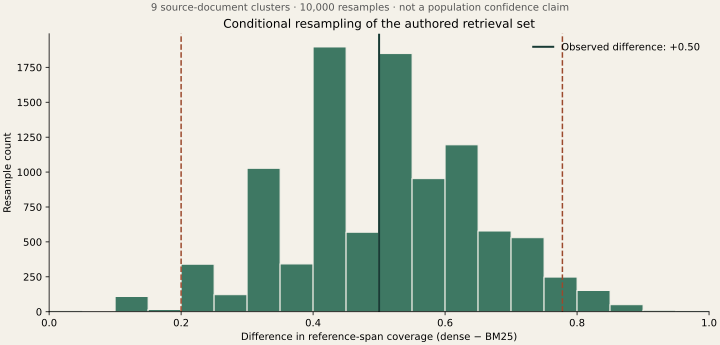

# What does a small evaluation let you conclude?

[Developer lab path](../README.md) · [Retrieval results](../retrieval/RESULTS.md) · [Evaluation guide](../../evaluation/README.md)

You changed a retriever and its score increased from 5/10 to 10/10. That is an observed improvement on these ten questions. Before turning it into a general claim, ask who wrote the questions, whether they share sources, how the comparison was selected, and what the metric actually checks.

This lab provides executable arithmetic for those questions. It makes no model calls and creates no new labels. The analysis was designed **after seeing the retrieval results**, so it is explicitly exploratory.

## Pair the same questions

We compare BM25-128 with dense-128 using complete reference-span coverage in the top three retrieved chunks. For each question, subtract the baseline outcome from the candidate outcome:

| Paired outcome | Questions |
|---|---:|
| Candidate succeeds, baseline fails | 5 |
| Candidate fails, baseline succeeds | 0 |
| Same outcome | 5 |

The observed mean difference is **+0.50**, or 50 percentage points. Both methods use the same ten questions and the same reference labels. Pairing preserves that relationship; treating the two result lists as unrelated samples would discard information about which questions changed.

These ten questions refer to nine documents. Two questions use the same idempotency document, so treating them as unrelated evidence of general performance is questionable. All documents also share an author and task style, which creates dependencies this small example cannot remove.

## Resample the document groups

The code samples nine document groups with replacement, keeps every question in each selected group, and computes the mean paired difference. It repeats this 10,000 times with seed 42. Sampling a group twice includes all its questions twice. Because group sizes differ, each draw can contain a different number of questions; the statistic remains question-weighted within that draw.

This is a transparent percentile-bootstrap illustration. Paired resampling keeps corresponding observations together; percentile endpoints summarize the resampled distribution. Other bootstrap methods have different properties, and this example is not a recommendation that the simplest method is always appropriate. [Primary implementation reference: SciPy bootstrap documentation](https://docs.scipy.org/doc/scipy/reference/generated/scipy.stats.bootstrap.html).



| Recorded calculation | Value |
|---|---:|
| Evaluation questions | 10 |
| Source-document groups | 9 |
| Resamples | 10,000 |
| Observed difference | +0.500 |
| Conditional 2.5th–97.5th percentiles | +0.200 to +0.778 |

**These bounds do not establish a population-level confidence claim.** The documents are authored rather than randomly sampled from a defined deployment population, the comparison was chosen after seeing results, and labels have no independent review. The resampling procedure also cannot invent failure types absent from its input. Every observed difference here is nonnegative, so its resampled means cannot become negative. A positive interval is not permission to claim the candidate wins everywhere.

The chart is useful for seeing sensitivity to this empirical collection. It does not fix the study design. The [report](results/analysis-2026-10-19/report.json) includes every paired observation, document group, and the complete distribution histogram.

## Why 10/10 is not certainty

Consider a separate **hypothetical** experiment with independent Bernoulli trials and a common success probability. A 95% Wilson interval gives:

| Hypothetical independent observations | Observed success rate | 95% Wilson interval |
|---|---:|---:|
| 10 successes out of 10 | 100% | 72.25%–100% |
| 100 successes out of 100 | 100% | 96.30%–100% |

The Wilson calculation uses the observed proportion, sample count, and a normal critical value to form bounds that remain within the probability range. Its confidence level describes a procedure's repeated-sampling behavior under its assumptions; it is not a posterior probability that a particular fixed interval contains the parameter. [NIST's formula and explanation](https://www.itl.nist.gov/div898/handbook/prc/section2/prc241.htm).

Those independent-trial assumptions are not automatically true for our authored evaluation. Running the same ten questions ten times does not turn them into one hundred independently sampled tasks. Repeated calls can measure generation variability, but broader task coverage still requires broader tasks.

The code also resamples an example where every paired difference is zero. Its interval is exactly `[0, 0]`. That means the empirical sample contains no observed paired variation; it does not prove the methods are equivalent on unseen tasks. Inspect assumptions before trusting an impressive-looking bound.

## A practical evaluation record

Before the next comparison, specify the target task population, sampling process, unit of analysis, metric, and primary comparison. Preserve paired task IDs across methods. Identify shared documents, users, or sessions that may require grouped analysis. Keep final evaluation cases separate from prompt or threshold tuning.

Then report the observed counts, effect size, failure examples, label-review status, and an uncertainty method appropriate to that design. If the sample cannot support inference, say so and use the observations to design the next experiment. Resampling is not a substitute for independently reviewed evidence.

## Reproduce

Python 3.10+ and the standard library are sufficient:

```bash
python3 -m unittest discover -s labs/eval-uncertainty -p 'test_*.py'
python3 labs/eval-uncertainty/check_saved.py
python3 labs/eval-uncertainty/analyze.py --output /tmp/uncertainty-analysis
```

Use a new output directory. The [protocol](PROTOCOL.md), frozen code, seed, and source-data hash identify the calculation. Offline checking reconstructs the entire report. Optional [plot.py](plot.py) regenerates the SVG and PNG with Matplotlib; the committed chart was rendered with version 3.9.3. Plotting is not needed to run the numerical checks.
