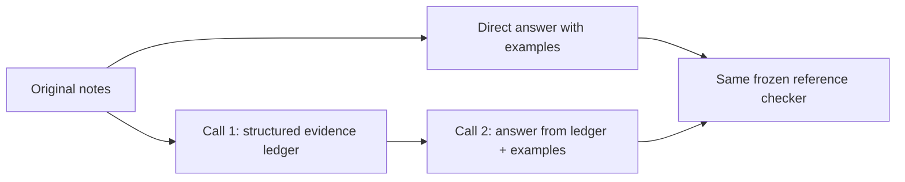

# Do better examples—or more steps—actually help?

[Developer labs](../README.md) · [First prompt comparison](../prompt-comparison/README.md) · [Results](RESULTS.md)

Examples can demonstrate a decision boundary, but adding them changes what the model sees. Reordering examples changes their position. Splitting a task changes both its cost and the information available at each step. This lab makes those differences explicit instead of treating all three as a single “better prompt.”

The task is to extract a confirmed owner and deadline from ten authored project notes. Some notes contain stale summaries, unaccepted proposals, withdrawn commitments, unresolved conflicts, relative dates, or quoted instructions. The policy and strict output contract are shared across conditions. The notes and reference answers are [local and inspectable](dataset.json); they are fictional examples, not customer data or an independent benchmark.

## Five conditions, three questions

| Condition | Demonstrations | Execution |
|---|---|---|
| None | No examples | One answer call |
| Simple | Two straightforward confirmed/partial cases | One answer call |
| Boundary | Two cases showing replacement, withdrawal, conflict, and quoted instructions | One answer call |
| Reversed | The exact boundary examples in reverse order | One answer call |
| Decomposed | Boundary examples in the final stage | Evidence-ledger call, then a fresh answer call |

**Selection:** compare simple with boundary. The example count is equal, but the text length and information differ. This is not an equal-token experiment.

**Order:** compare boundary with reversed. Only the demonstration ordering changes in the assembled request. Notes and their order remain fixed. Two repetitions are too few to establish reliable order insensitivity.

**Decomposition:** compare boundary with decomposed. The extra call creates an explicit evidence ledger; the final call sees that ledger instead of the original notes. This tests the whole pipeline, including possible information loss. It does not isolate a magic phrase or reveal the model's internal reasoning.



## What the ledger is for

The first stage is asked to preserve events, their kinds, values, and exact supporting excerpts. Those are reviewable task artifacts. A useful decomposition gives later steps a sufficient representation of the evidence; a lossy one can turn a valid conclusion into a guess.

The host in this experiment passes the ledger through without semantic repair. A successful first call is not proof its ledger is valid or complete. The final stage also receives an empty original-note array followed by an explicit instruction to use the ledger; the exact request is retained so this assembly choice can be inspected. Do not copy this prototype into a production pipeline without intermediate validation and a defined response to missing or contradictory evidence.

The saved verifier reconstructs the ledger-to-answer input exactly. It does **not** independently certify every intermediate event. Final reference checks test the extracted outcome, not every possible defect in the intermediate representation.

## Procedure and evidence

The [protocol](PROTOCOL.md) was frozen before execution. Two repetitions use a declared rotating order, totaling at most twelve model calls. This does not fully counterbalance all five positions. The runner requests `gpt-6.1-sol` at low reasoning effort using fresh ephemeral Codex sessions. Temperature and seed are not controlled; the requested model name is not a separately verified server revision.

Ten notes share each batch. Repeated notes and batch answers are correlated, so twenty case observations per condition are not twenty independent trials. There is no outcome-driven prompt tuning or best-run selection. The scorer is reused from the earlier extraction pilot and rejects malformed batches separately from valid JSON with wrong field values.

Read the [results](RESULTS.md) for every repetition and the paired changes. Original prompts, code, policy, labels, exact requests, final outputs, and intermediate ledgers are retained under [the recorded run](results/pilot-2026-10-19/manifest.json). Private account metadata and hidden reasoning are not included.

## Verify or repeat

Offline checks need Python 3.10+ only:

```bash
python3 -m unittest discover -s labs/example-design -p 'test_*.py'
python3 labs/example-design/check_saved.py
```

Five tests cover example ordering, separation of labels from inputs, scheduling, duplicate keys, invalid dates/IDs/types, schema rejection, and field-level errors. The 41-statement assembly/scoring module reached 100% line coverage in this run. This measures exercised code, not the adequacy of authored labels or the completeness of the task distribution.

Fresh generation requires an authenticated Codex CLI with access to the requested model. It consumes account usage with no enforced dollar cap. The runner allows twelve calls at most, a 180-second timeout per call, no retries, and requires a new destination:

```bash
python3 labs/example-design/run.py --output /tmp/example-design-new-run
```

Changing labels, examples, or prompts creates a new experiment. Preserve this baseline, declare the change before running, and use new evaluation notes if you tuned against these published ones. Independent task review and broader naturalistic tasks remain needed before stronger claims.
