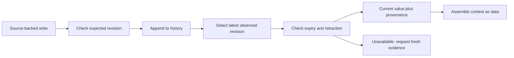

# Memory is stored state with a lifecycle

[Developer lab path](../README.md) · [Context and memory](../../handbook/04-context-and-memory.md)

An assistant remembers a meeting room as Room A. A later decision changes it to Room B. Saving both sentences is easy; deciding which one belongs in the next request is the engineering problem.

This lab implements a small SQLite store and executes a complete write → retrieve → correct → expire → retract sequence. It then builds the actual context packet an application could supply to a model. There are no model calls: this demonstrates the application state and selection rules underneath memory, without claiming that a model interpreted the packet correctly.

## Run and inspect

Python 3.10+ and its standard library are sufficient. No account, external service, or packages are needed. Use a new output directory:

```bash
python3 labs/memory-lifecycle/run.py --output /tmp/memory-lifecycle-run
```

That creates a SQLite database, frozen source files, and a readable JSON transcript. The [committed transcript](results/run-2026-10-19/transcript.json) records the executed scenario; the binary database is regenerated locally rather than committed.

| Event | Observed result |
|---|---|
| Save the first decision | Room A, revision 1, source `decision-1` |
| Correct the decision | Room B, revision 2, source `decision-2` |
| Build the next context packet | Only the current Room B fact, including revision and source |
| A delayed worker writes against revision 1 | Rejected; no revision created |
| Another namespace stores the same key | Its Room Z value remains separate |
| Close and reopen the database | Room B remains available |
| The correction expires | `expired`, value `null`; Room A is not revived |
| Retract the fact | `retracted`, value `null`, with revision 3 retained |
| Ask for an earlier observation date | The historical Room A revision is still inspectable |

The dates in the example are fictional application inputs. Expiry is exclusive: a fact expiring on March 8 is unavailable starting March 8. Historical lookup means “latest revision observed by this date,” not proof of what was true in the world on that date.



## Why the order of checks matters

Revision 1 remains valid until March 20. Revision 2 corrects it but expires on March 8. On March 9, a query that filters out expired rows *before* selecting the latest revision could accidentally return Room A. That resurrects a superseded fact.

The [store implementation](memory.py) first finds the latest observed revision, then checks whether that revision is expired or retracted. If so, the application gets an unavailable status. It needs new evidence; an old row is not an automatic fallback.

A writer supplies the revision it read. The update compares that expected revision inside an immediate SQLite transaction. A stale writer gets a conflict rather than silently overwriting a newer decision. The test suite exercises two connections with interleaved writes; it is not a distributed-system concurrency benchmark.

## What goes into the model request?

The executed context packet contains an instruction, an explicit as-of date, and data like:

```json
{
  "key": "meeting-room",
  "status": "current",
  "value": "Room B",
  "revision": 2,
  "source": "decision-2"
}
```

The host chooses the namespace and key, retrieves a current value, and assembles the packet. In a larger system, search might help choose candidate keys, but it must not bypass currentness or access checks. A similarity score does not resolve which revision is authoritative.

The packet labels values as data. That is useful instruction design, not a complete defense against malicious stored text. The application still needs appropriate trust boundaries and independent output/action checks. This store accepts explicitly supplied facts; it does not infer whether a source is truthful or whether an assistant has permission to save a user preference.

## Boundaries a real application still needs

The namespace filter is enforced by this API, but caller authentication and database-file access controls are not implemented. A caller with direct database access can bypass the API. Do not let a model choose an arbitrary user's namespace and call that authorization.

Retraction prevents later current-value retrieval while keeping history. It is not deletion for privacy or retention purposes. A production design must decide what to store, who can inspect history, and how to delete data from storage and backups when required. This fixture contains only fictional room names and source identifiers.

The API is append-only; it does not resolve contradictory equal-authority sources automatically. An application needs an explicit adjudication or conflict state for that situation. Revision order records accepted application writes, not a universal truth hierarchy.

## Verification

```bash
python3 -m unittest discover -s labs/memory-lifecycle -p 'test_*.py'
python3 labs/memory-lifecycle/check_saved.py
```

Tests cover correction, stale writes, expiry, retraction, namespace selection, historical visibility, persistence, invalid dates, SQL-like input, and interleaved connections. The checker reruns the full scenario on a fresh database and compares every transcript event. [Predeclared protocol](PROTOCOL.md) and frozen source hashes identify the actual recorded implementation.
