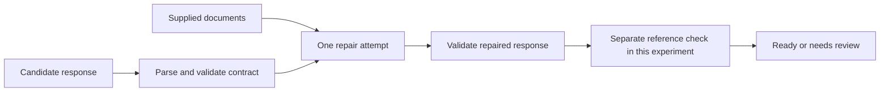

# Repair the output without inventing the missing facts

[Developer lab path](../README.md) · [Evaluation](../../evaluation/README.md)

A downstream application needs a task record, not an almost-valid JSON string. But parsing successfully is only the first gate. A response can use the right fields and valid dates while assigning work nobody accepted.

This lab gives a model three **authored faulty responses**, permits one repair attempt per case, and independently checks the result. The initial faults are deliberately injected examples, not observed model failure rates. The repairs are actual recorded model outputs.



## Three failures, three different lessons

| Injected fault | Before repair | Required outcome |
|---|---|---|
| Trailing comma | JSON parsing fails | Return valid JSON while preserving unknown fields as null |
| Invented commitments | Schema and citations pass, reference check fails | Remove proposed owner/date because nobody accepted them |
| Missing source document | Claimed citation is unavailable | Return `needs_review` with no records |

The supplied note says Morgan proposed ownership of an export and suggested a date; nobody accepted either. For cases with that note available, the authored reference is:

```json
{"status":"ready","records":[{"task":"export","owner":null,"deadline":null,"sources":["note-1"]}]}
```

Here, `ready` means the extraction record is ready to consume under this contract, including its explicit unknowns. It does not authorize performing the task or treating the unknown values as confirmed. With no documents, the expected result is:

```json
{"status":"needs_review","records":[]}
```

A real host can detect the empty evidence set and route directly to review without spending a model call. This fixture deliberately records a model response to show the required boundary; it is not an efficiency recommendation. That status is data returned to a caller. This demonstration does not contact or enqueue a human reviewer.

## Read the actual implementation

The [contract validator](contract.py) rejects invalid JSON, duplicate keys, extra fields, wrong types, impossible calendar dates, and citations outside the supplied documents. It does not use a vague “confidence” field as a substitute for checks.

The valid-but-invented fixture passes the entire contract validator. That is intentional: a known source ID proves neither that the source supports the claim nor that the model interpreted it correctly. The separate reference check has authored expected answers for these fixtures. A production application will need appropriate verification or review; it does not magically possess this test oracle.

The [repair prompt](prompt.txt) receives the documents, candidate, and contract errors. It does not receive the expected reference object. It asks for a fresh evidence check even when the contract-error list is empty. This prevents the experiment from treating schema acceptance as truth acceptance.

## Recorded result and limits

One `gpt-6.1-sol` low-reasoning call per fixture, with a 180-second timeout and no automatic retries. The [manifest](results/pilot-2026-10-19/manifest.json) preserves before/after judgments, commands, durations, and source hashes. Full requests, raw outputs, and runtime logs sit beside it. All three repaired responses passed the contract and matched their authored references. The offline checker verifies every request and recomputes both kinds of judgment.

This is application-level, prompt-based JSON repair through Codex. It does not use or claim a provider-native constrained-output API. Provider schema controls can address format adherence; evidence correctness remains a separate question. Three small authored fixtures cannot establish a general repair rate or justify unlimited retries.

## Run the checks or repeat the experiment

Offline checks require Python 3.10+ only:

```bash
python3 -m unittest discover -s labs/output-repair -p 'test_*.py'
python3 labs/output-repair/check_saved.py
```

To make three new model calls, use an authenticated Codex CLI with access to the recorded model and a new output directory. This consumes account usage:

```bash
python3 labs/output-repair/run.py --output /tmp/output-repair-run
```

The [protocol](PROTOCOL.md) fixes the scope before execution. A model-call failure is retained, not silently replaced. In a real application, a repair that still fails the required checks should remain unavailable to downstream actions and return a visible failure/review state. Repeating the same unsupported answer until a validator accepts its syntax is not evidence recovery.
