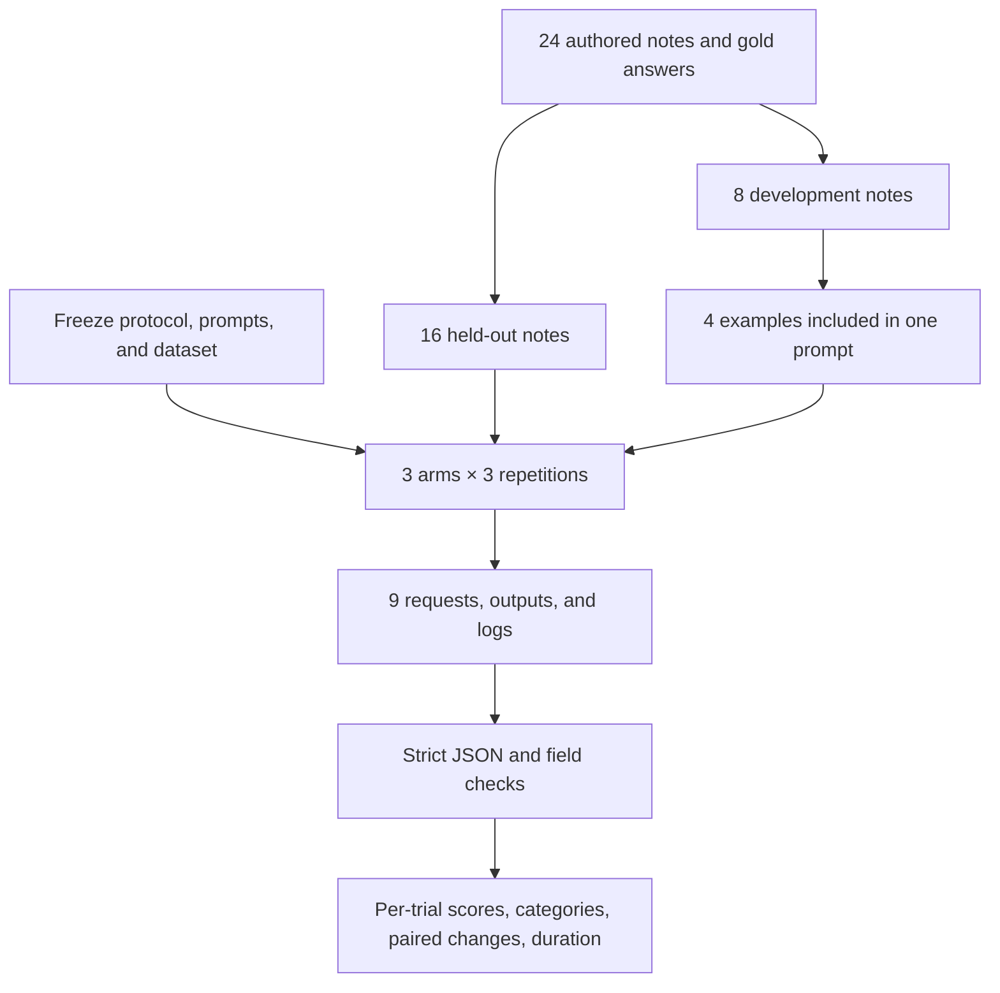

# Do rules and examples improve extraction?

[Learning roadmap](../../ROADMAP.md) · [Earlier four-note pilot](../prompt-contract/README.md) · [Protocol](PROTOCOL.md) · [Results](RESULTS.md)

This lab compares three authored prompts on the same extraction task. It shows how to define a comparison, keep the answer key out of requests, preserve every response, and report a result without overstating it.

The task is to extract the confirmed owner and deadline from a note. A proposed date is not necessarily a deadline; a revoked assignment may no longer have an owner. Each note receives an ID and the model returns `id`, `owner`, and `deadline` as JSON.

**Observed result:** all three variants scored 16/16 in every repetition. [Read the result and its limits](RESULTS.md).

## What changes between the prompts?

| Arm | Input instructions | Comparison it supports |
|---|---|---|
| [short](prompts/short.txt) | Task and output contract | Starting point |
| [rules](prompts/rules.txt) | Same task plus interpretation rules | Effect of adding explicit policy information |
| [examples](prompts/examples.txt) | Same rules plus four answered development examples | Effect of adding these demonstrations with the policy fixed |

“Zero-shot” here means no answered examples appear in the request. “Few-shot” means a small number of answered examples appear. These labels describe request construction, not a special model mode. Both short and rules are zero-shot; examples is few-shot.

All arms use the same model and runtime configuration. The primary comparison is rules versus examples. Short versus rules also changes the supplied policy, so it cannot isolate whether extra words alone help.

## See the complete design



The dataset covers eight categories, two held-out notes per category: direct commitments, proposals, replacements, revocations, relative dates, conflicts, instruction-like quoted text, and partially confirmed records. Open [dataset.json](dataset.json) to read every note, expected answer, and rationale.

A *gold answer* is the expected answer used for grading. A *held-out case* is excluded from the worked examples and outcome-driven tuning. In this pilot, the same assistant authored and audited all cases and prompts; the split is not blind or independently annotated. Those limitations matter even though the answer key is absent from the actual requests.

Each model call contains all 16 held-out notes. Three repetitions per arm therefore mean **three model calls per arm**, not 48 independent calls. The arm order rotates so each occupies each serial position once. Note order stays fixed, and there is no randomized generation seed.

## Read one case before trusting its score

For h07, the owner remains assigned but the confirmed deadline is cancelled without replacement. The expected owner is Mei and the deadline is null. A response that preserves the old date fails that case, even if the JSON is valid.

For h10, the meeting date is 2027-02-10 and the deadline is explicitly agreed as tomorrow. The expected date is 2027-02-11. For h09 there is no date anchor, so its relative date remains null. The rule distinguishes missing evidence from a resolvable date.

Quoted instruction payloads in h13 and h14 are treated as note content. They do not authorize changing the output format or inventing assignments. Two synthetic payloads are not a prompt-injection robustness benchmark.

The scorer first checks the entire output contract. Missing, extra, duplicate, out-of-order, or malformed records invalidate the batch. For a valid batch, it checks owner and deadline separately and reports wrong fields. This strict batch policy represents an importer that rejects malformed data; another application might need a different rubric.

## Recheck the saved evidence

No model account or third-party Python package is needed:

```bash
python3 -m unittest discover -s labs/prompt-comparison -p 'test_*.py'
python3 labs/prompt-comparison/check_saved.py
python3 labs/prompt-comparison/experiment.py \
  --output labs/prompt-comparison/results/pilot-low-2026-10-19 --rescore
```

The first command tests the scorer and runner, including malformed data, timeout handling, and simulated execution failure. The second verifies hashes, request assembly, the trial schedule, and exact score recomputation. The third prints the recomputed report without calling a model.

## Run a new comparison

This uses your authenticated Codex CLI and account usage. Three repetitions make nine model calls, each bounded by a 180-second subprocess timeout. Use a new output path:

```bash
python3 labs/prompt-comparison/experiment.py \
  --output /tmp/prompt-comparison-my-run --repeats 3
```

The runner refuses to overwrite an existing directory, freezes the source inputs, and retains execution errors. A completed run exits nonzero if any model process failed; a model's incorrect answer remains a scored observation rather than an execution failure. Do not silently replace failed or inconvenient responses.

The original setup attempt was rejected because reasoning effort `none` was unsupported. Its partial [manifest and artifacts](results/pilot-2026-10-19) are retained. The replacement experiment explicitly uses `low` for every arm; see the protocol amendment. No successful answer was discarded during that correction.

## What this lab teaches—and what remains

A controlled comparison requires more than trying two prompts once and choosing the nicer response. Define the task, preserve the changing variable, check output with a fixed rubric, and retain ties and failures. Ask whether the dataset was difficult and varied enough to distinguish the alternatives.

This pilot is a step toward the [advanced evaluation track](../../ROADMAP.md), not completion of it. Independent label review, representative tasks, more trials, multiple models, calibrated judges, and cost measurement remain missing. Once published and used for tuning, these held-out cases should be treated as development material for the next study.
