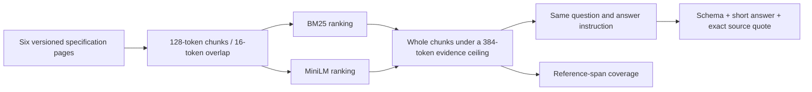

# From real documentation to a checked answer

[Developer labs](../README.md) · [Earlier retrieval experiment](../retrieval/README.md) · [Results](RESULTS.md)

A retriever can return the right topic while missing the sentence needed to answer. A model can also return the right value without a valid supporting quote. This lab measures both stages on six official MCP specification pages instead of an invented knowledge base.

**Historical scope:** every question targets MCP **2025-06-18**, as stored at upstream commit `300730a13c808a11967c75efbcc1649221ac4a17`. This is a reproducible corpus, not guidance about the latest protocol. The [source manifest](sources/manifest.json) links each original page and records its hash. Files are unchanged, including Markdown/MDX markup, with the [original MIT license](sources/LICENSE). Current upstream licensing or specifications may differ.



**Method names:** BM25 ranks chunks using matching words and term statistics (`--method bm25`). Dense retrieval compares numerical text representations; this lab uses the MiniLM embedding model to produce those vectors (`--method dense`). Neither method guarantees that the selected text answers the question. See the [glossary](../../handbook/glossary.md) for the terms.

## What stays equal

Both methods rank the same 90 chunks. Each evidence packet has the same maximum of **384 MiniLM tokens**, including chunk IDs and separators. The packer considers ranked chunks in order, skips chunks that do not fit, and recounts the entire assembled packet. It never cuts a selected chunk to fill the last few tokens.

A shared ceiling is not identical realized length: the methods may select different text volumes. MiniLM is the retrieval tokenizer, **not the answer model's tokenizer**. This experiment controls evidence size using an explicit reproducible measure; it does not claim equal hosted input-token charges or a full context-window calculation. The exact requests and their character counts are retained. Tokenizing complete documents or rejected oversized candidates may emit a tokenizer length warning; those strings are not passed to the embedding model. Encoder batches are explicitly checked to fit 256 tokens including special tokens.

The answer instruction, requested generator (`gpt-6.1-sol`, low reasoning effort), question, and output contract remain the same between methods. Each of six evaluation questions gets one call per method. There are two additional development questions with retrieval results only. These authored questions were fixed before execution, but neither the labels nor the experiment have independent human review.

## Read the checks separately

| Measurement | What passes | What remains unproven |
|---|---|---|
| Complete reference coverage | Selected source intervals contain the authored reference span | Equivalent evidence might exist elsewhere; generation might still fail |
| Schema | Required keys, state, and field types match the contract | Values are factual |
| Short-answer match | Answer matches a predeclared accepted value after case/whitespace normalization | The model used supplied evidence |
| Quote provenance | Quote is an exact substring of the cited selected chunk | Quote entails the answer |
| Narrow supported answer | Correct value + valid quote + complete reference phrase inside quote | General semantic entailment or independent correctness |

The last metric is deliberately strict. A partial quote or equivalent passage can fail even when the short answer is right. Inspect the raw response before calling every scoring failure a factual error. Conversely, a right value alone does not demonstrate grounding: these public specifications may be present in model pretraining.

All six evaluation questions are answerable somewhere in the complete corpus. If the selected packet lacks support, abstaining can be appropriate. We report abstentions separately; they do not count as successful answer resolution. This dataset does not test questions that are unanswerable in the full corpus.

## Inspect or reproduce

Run these commands from the repository root (the folder containing `START-HERE.md`). Start with the same question under both methods, without model packages or an account:

```bash
python3 labs/real-docs/view_results.py --method bm25 --question no-cancel
python3 labs/real-docs/view_results.py --method dense --question no-cancel
```

The viewer shows the exact selected evidence, recorded answer, and authored reference separately. Overlapping chunks are not deduplicated, so some of the shared budget can be spent on repeated text.

No account or model packages are needed for the saved checks:

```bash
python3 -m unittest discover -s labs/real-docs -p 'test_*.py'
python3 labs/real-docs/check_saved.py
```

The standard-library checker verifies source hashes and spans, recomputes rankings from stored vectors, reconstructs every input, and regrades every retained answer. It verifies recorded token-count consistency; it does not rerun tokenization by default.

For exact tokenizer and greedy-packing replay, use the [pinned model environment](../model-mechanics/requirements.txt) with the encoder tokenizer already cached:

```bash
python3 labs/real-docs/check_saved.py --retokenize
```

A fresh complete run additionally needs an authenticated Codex CLI with access to the requested generator. It makes **at most 12 account-consuming calls**, each with a 180-second timeout and no retry. It does not enforce a dollar spending cap. Read the [protocol](PROTOCOL.md) first, use a new output directory, and install the pinned model packages in a separate environment:

```bash
python3 labs/real-docs/run.py --output /tmp/real-docs-new-run
```

Add `--offline` only when the exact encoder/tokenizer revision is cached. That flag disables model-asset downloads; **the answer calls still require the hosted service**. Offline artifact verification is the first command above.

The runner saves source/code snapshots, vectors, all rankings and selected packets, exact input and final output text, process status, duration, and scores. It omits hidden reasoning and account/session metadata. The runtime's requested model is recorded; these artifacts do not establish a separately resolved server model identifier or billed cost.

## Why this is still a small pilot

The real documents are longer and less tailored to the questions than the fictional corpus, but the questions are short authored extraction tasks with mostly explicit terms. There are no repeated model runs, independent reviewers, paraphrase families, access-control conditions, or hostile-document modifications. The raw MDX is indexed rather than rendered, which is a deliberate preprocessing choice that may affect ranking.

Use the [practicum](../PRACTICUM.md) to design a follow-up: freeze new questions before tuning, inspect ranking and packing failures separately, retain the simple baseline, and compare task-level regressions. Do not translate six outcomes into a universal ranking of retrieval methods.
