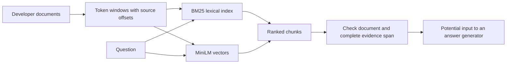

# Build a retriever, then inspect what it actually returned

[Developer lab path](../README.md) · [Context chapter](../../handbook/04-context-and-memory.md) · [Raw result summary](RESULTS.md)

You are building an assistant for a fictional developer platform called Lumen. A user asks: “The response disappeared after creating a document. How do I avoid creating it twice?” The knowledge base contains a duplicate-prevention policy, but the answer is only useful if the relevant instruction reaches the answer generator intact.

This lab implements lexical and embedding search, token-window chunking, and evidence checks. It is a retrieval experiment: it does not generate answers or measure answer accuracy. All documentation and questions are authored examples, not production API guidance.



## Start by inspecting a failure

No dependencies beyond Python 3.10+ are required to inspect the saved run:

```bash
python3 labs/retrieval/view_results.py --condition dense-48 --question double-write
python3 labs/retrieval/view_results.py --condition dense-128 --question double-write
```

The first command shows the actual top three small chunks. The correct document ranks first, but the selected chunks omit the beginning of the reference instruction:

```text
When retrying the same logical write, send the same Idempotency-Key
and the same request body.
```

One selected fragment begins halfway through the tokenized identifier. Another discusses avoiding duplicate creation without preserving the full instruction. The larger-window condition covers the reference sentence in its top three results. Inspect source offsets to see exactly where each fragment came from.

This metric is deliberately narrow: **complete reference-span coverage** is not identical to answerability. Another passage might express equivalent information, and a model might infer part of the answer from fragments. Conversely, returning the full sentence does not guarantee that an answer generator follows it. The metric makes one inspectable retrieval requirement explicit.

## What was compared

The [corpus](corpus.json) has ten fictional developer documents totaling 1,714 whitespace-separated words. Topics include retries, idempotency, rotation, webhooks, pagination, throttling, privacy, graceful shutdown, caching, and migrations. The [questions](queries.json) contain two development examples and ten evaluation questions with exact evidence spans. One agent authored both sets; they are not independently reviewed or representative of real customer traffic.

| Choice | Implementation |
|---|---|
| Lexical search | BM25, k1=1.2 and b=0.75; lowercase word tokens, no stemming or stopword removal |
| Embedding search | Pinned `all-MiniLM-L6-v2`; masked mean pooling and L2 normalization; dot-product ranking |
| Chunking | 48 or 128 MiniLM tokens, 16-token overlap; original character offsets preserved |
| Long-window baseline | First 254 tokens of each document plus two special tokens; suffix omitted explicitly |
| Ties | Chunk ID order |
| Evaluation | Document hit and complete reference-span coverage at top 1 and top 3, plus text volume |

The same token windows are used for both retrieval methods. Only document text is indexed; the reference question and answer are not inserted into chunks. The encoder inputs are checked against a 256-token limit. This separates deliberate baseline truncation from unnoticed library truncation.

## Observed results

| Condition | Correct document first | Complete evidence in top 3 | Mean top-3 characters |
|---|---:|---:|---:|
| BM25, 48 tokens | 5/10 | 3/10 | 708 |
| Embeddings, 48 tokens | 9/10 | 4/10 | 737 |
| BM25, 128 tokens | 7/10 | 5/10 | 1,816 |
| Embeddings, 128 tokens | 10/10 | 10/10 | 1,794 |
| Embeddings, first 254 tokens | 10/10 | 10/10 | 3,531 |

The largest-window baseline also succeeded. We did not hide it to favor a more elaborate design. Its selected text volume is substantially higher, and this corpus places the reference facts early enough to survive its truncation. It does not demonstrate that truncating real documents is safe.

Small windows can isolate topical fragments while losing complete instructions. Larger windows cost more context and can include distracting material. Overlap helps only when the retriever actually selects the necessary neighboring chunks. Equal top-k is not an equal-token-budget comparison. These results do not establish a universal winner; the [full table](RESULTS.md) retains every evaluation question.

## Reproduce the index and evaluation

Use the [same pinned Python packages](../model-mechanics/requirements.txt) as the model-mechanics labs. The encoder is a separate download; weights are not committed. The first run needs network access, but no paid API or model account:

```bash
python3 -m venv /tmp/retrieval-env
/tmp/retrieval-env/bin/pip install -r labs/model-mechanics/requirements.txt
/tmp/retrieval-env/bin/python labs/retrieval/run.py --output /tmp/retrieval-run
```

After downloading the exact model revision, add `--offline`. Use a new output directory for every run. The recorder freezes the corpus, questions, code, and [protocol](PROTOCOL.md) and saves actual vectors, rankings, source offsets, versions, and encoder durations. Check [the model card](https://huggingface.co/sentence-transformers/all-MiniLM-L6-v2/tree/1110a243fdf4706b3f48f1d95db1a4f5529b4d41) for the encoder's intended use and Apache-2.0 license. Our implementation uses its masked-pooling approach; this is not a recommendation that it is the best current encoder.

Offline verification requires only the standard library:

```bash
python3 -m unittest discover -s labs/retrieval -p 'test_*.py'
python3 labs/retrieval/check_saved.py
```

A separate Python environment reproduced all vectors, rankings, and evidence metrics; see the [verification record](VERIFICATION.md), including a corrected packaging failure. The checker recalculates every rank and metric from saved vectors. Score comparison allows `1e-10` floating-point tolerance; ranking and evidence decisions must match exactly. The initial BM25 run summed a set of query terms, causing cross-process score differences around `1.8e-15`. Current code sorts those terms for deterministic summation; the original frozen code and scores remain retained. No ranking or reported count changed.

## Where a developer takes this next

For your own documents, replace the corpus and define relevance/evidence labels before comparing configurations. Preserve source IDs, versions, and offsets. Keep questions for final evaluation separate from tuning. Inspect retrieval failures before changing the answer prompt.

A production system also needs permission filtering, document freshness, index migrations, latency and storage budgets, no-answer handling, and adversarial-content controls. None is established by these ten questions. An embedding score is a similarity measure, not a calibrated probability that a chunk answers the question. This lab deliberately reports no fabricated generated responses or production-readiness claim.
