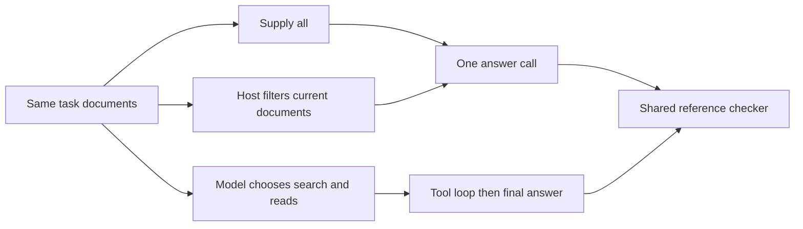

# Choose a workflow before adding autonomy

[Developer lab path](../README.md) · [Bounded agent](../bounded-agent/README.md) · [Evaluation](../../evaluation/README.md)

A model does not need to choose every step of every task. This lab runs the same library questions through three strategies and records what each buys—and what it costs in calls and request volume.

| Strategy | Who selects the documents? | What the model does |
|---|---|---|
| Single call | The host includes every document for the task | Answer once |
| Fixed workflow | A deterministic host rule selects every `status=current` document | Answer once |
| Agent | The model searches metadata and chooses document reads | Continue through tool results, then answer |

The fixed rule is intentionally simple and tailored to this corpus. It is not a general retrieval solution. The single-call input is small enough to fit; this experiment does not test very large collections. The agent uses JSON action dispatch rather than native provider tool calls.



## Two tasks, repeated twice

The routine task contains a superseded draft and an approved current plan. The conflict task adds an equally authoritative current document with incompatible start time and capacity. Registration is explicitly undecided in both current documents.

All strategies must answer the same three questions. For the conflict task, identifying the contradiction is correct; choosing either start time as certain is not. Both current documents must be considered. The agent's search exposes both in metadata, so ignoring one is a selection/coverage failure rather than an unavailable-source excuse.

The [protocol](PROTOCOL.md) fixes two repetitions, strategy order, prompts, grading rules, and the call cap before execution. Single and fixed share an exact answer prompt. The agent has an action-format prompt and additional decision steps. The comparison therefore evaluates these complete approaches, not an isolated wording change.

## Inspect the evidence

[Results](RESULTS.md) report every task/repetition. The [manifest](results/pilot-2026-10-19/manifest.json) retains all calls, final answers, tool traces, scores, durations, and request-character counts. Each run directory includes the exact input, raw output, runtime log, and selected-document or agent-state artifact. Original code, prompts, corpus, and scorer are frozen with hashes.

The grader distinguishes correctness from resolution. A supported value or explicitly documented undecided field counts as resolved. A correctly reported conflict does not resolve which disputed value should be used. The same rule applies to all strategies.

Call durations include CLI/service overhead and are summed per task. Request characters measure the text submitted across calls, including repeated history. They are not tokens, paid usage, or invoices. Dollar cost was not collected. Two repetitions of two authored tasks do not establish a robust latency ranking or broad accuracy estimate.

## Run or extend

Offline checking needs Python 3.10+ only:

```bash
python3 -m unittest discover -s labs/workflow-comparison -p 'test_*.py'
python3 labs/workflow-comparison/check_saved.py
```

A live repeat needs an authenticated Codex CLI and access to `gpt-6.1-sol`. It consumes at most 32 model calls: six per agent run and one per other run. Use a new output directory:

```bash
python3 labs/workflow-comparison/run.py --output /tmp/workflow-comparison
```

The runner retains a failed model call and stops that task rather than retrying until success. It does not resume a partially executed comparison; use the saved artifacts to diagnose interruption before deciding whether another complete experiment is warranted.

For your task, begin with the least complicated approach that has the required capabilities and passes your evaluation. Consider an agent when the needed actions genuinely depend on intermediate results. Measure it against the fixed alternative, including missing-evidence and conflict cases. This lab does not establish that one architecture is universally preferable.
